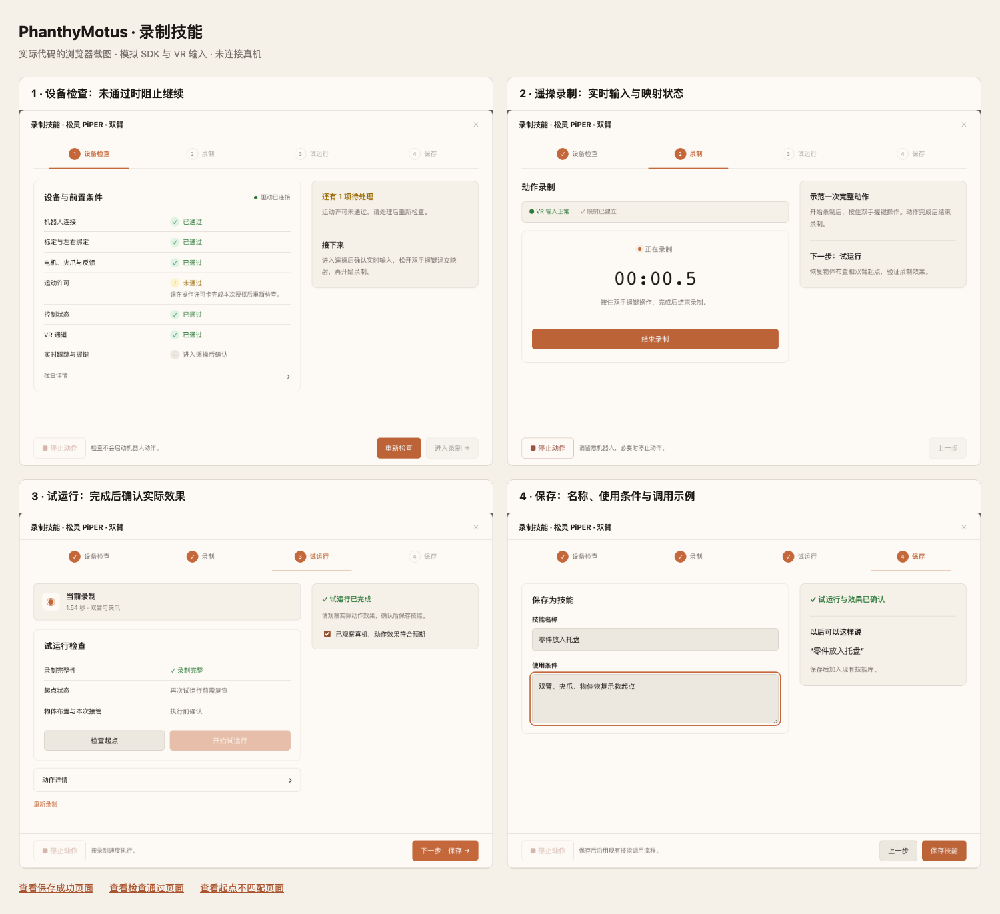

# 网页示教实际界面与验收范围

以下图片由 `tests/test_teaching_browser.py` 在 2026-10-14 的浏览器验收中生成，展示本分支的实际代码，使用模拟 PiPER SDK 和 VR 输入。不是设计效果图，也不是机器人现场照片。没有连接真实 CAN、头显或 ROS2 DDS 网络，没有调用真实 LLM。

测试使用 Core 的实际画布、工作台宿主、技能页面、MCP 代理、导入 API 和临时 SQLite；替换与测试无关的启动逻辑和未使用的 3D 渲染器。截图中的试运行及效果勾选来自自动化模拟，不代表已完成真机效果确认。



| 界面 | 当前行为 |
| --- | --- |
| [设备检查未通过](00-check-blocked.png) | 分项显示原因；运动许可不通过时禁用进入录制。 |
| [设备检查通过](01-check.png) | 六项检查通过；实时跟踪和握键仍明确标为进入遥操后确认。 |
| [录制中](02-record.png) | 显示有效实时输入、映射状态和服务端计时；提供结束录制与停止动作。 |
| [起点不匹配](03-start-mismatch.png) | 阻止试运行；动作曲线与关节差异折叠在详情中。 |
| [试运行完成](04-trial.png) | 保留录制完整性结果；再次试运行需重新检查起点；保存前确认动作效果。 |
| [保存表单](05-save.png) | 只需填写名称、使用条件；显示生成的调用说法。 |
| [保存完成](06-saved.png) | 导入现有 Skill 库；根据执行卡连接状态提示后续 Agent 调用。 |

下载本目录后可在浏览器打开 [index.html](index.html) 查看完整画廊。GitHub 上可直接点击各张 PNG。

## 页面入口和设备绑定

从已注册的 PiPER Driver 添加 `piper_teaching` 执行卡，选择「录制技能」并点击原有「执行」。没有新增全局示教按钮。Driver 通过 MCP 返回页面 HTML，Core 在隔离的 iframe 中展示；页面操作固定转发到打开页面的 MCP 服务、工具和卡片实例。

一张示教卡片可以生成多个普通 Skill。轨迹与资产定义持久化到 Driver 的 `data_dir/recordings/`、`data_dir/skills/`；Skill 定义保存到当前 Core 的 `skills.installed`，不需要资源中心账号。

## 调用能力的实际边界

- 网页没有新增聊天输入框。保存页的调用示例用于已有语音或消息渠道驱动的 Agent；需要把执行卡连接到决策核心。
- 「运行技能」目前仍是填写 `asset_id`、预览并确认的参数表单；按保存名称选择并运行的便捷页面尚未完成。
- Skill 当前记录工具名和资产 ID，尚未固定来源 MCP 服务 / 卡片。多台同型设备的明确路由仍待完善；本次验收覆盖一个绑定的模拟设备。
- 生成的是保持原有速度和场景条件的录制回放技能，没有训练策略、视觉定位或环境泛化。起点由操作者通过已有控制功能恢复。
- 生产部署、Docker 镜像构建、真实 LLM 调用、现场 VR 跟踪、CAN 时序、标定和实际任务效果未验证。

## 验证与复现

本次同步 Driver PR #395 的 `ef2b3d79` 后重新运行：

| 检查 | 结果 |
| --- | --- |
| Driver 示教、双臂、轨迹、遥操协议、Dockerfile 路径检查 | 151 passed, 2 skipped |
| Core 本地导入、MCP 注册与调用错误回归 | 32 passed |
| 跨仓浏览器流程 | 5 passed；3 条既有 Pydantic 弃用提示 |

总计 188 项通过、2 项跳过。两个跳过来自既有 Dockerfile 参数收集对 `.worktrees` 路径的排除；新增示教测试显式执行 PiPER Dockerfile 的复制文件及导入覆盖检查并通过，不代表已实际构建镜像。

Driver 检查：

```sh
uv run --no-project --with pytest --with numpy --with pyyaml python -m pytest -q \
  tests/test_piper_teaching.py tests/test_piper_dual.py tests/test_piper_trajectory.py \
  tests/test_teleop_contract.py tests/test_dockerfile_copies.py
```

Core 检查（在配套 Core checkout 的 `agent-core/` 下）：

```sh
uv run --no-project --with pytest --with numpy --with pyyaml \
  --with fastapi --with python-multipart --with httpx --with aiohttp --with aiofiles \
  --with openai --with html2text --with jsonschema python -m pytest -q \
  tests/test_skill_import.py tests/test_mcp_registry_merge.py tests/test_mcp_call_errors.py
```

浏览器检查（在本仓根目录，`TEACHING_CORE_ROOT` 指向配套 Core checkout，预先安装 Playwright Chromium；或用 `PLAYWRIGHT_CHROMIUM_EXECUTABLE` 指定可执行文件）：

```sh
TEACHING_CORE_ROOT=/path/to/phanthymotus \
TEACHING_SCREENSHOT_DIR=/tmp/teaching-screenshots \
uv run --no-project --with pytest --with numpy --with pyyaml --with playwright \
  --with uvicorn --with fastapi --with python-multipart --with httpx \
  --with aiohttp --with aiofiles --with openai --with html2text --with jsonschema \
  python -m pytest -xq tests/test_teaching_browser.py
```

`overview.png` 是本目录 HTML 画廊的浏览器整页截图；各步骤 PNG 直接由测试截图生成。关于接入接口、设备检查和持久化约束，见 [通用示教说明](../../common/teaching/README.md)。
