# G1 遥操录制 → Skill

下方流程图来自 2026-10-15 的实际浏览器测试，使用真实 Core 工作台、MCP 代理、SQLite 技能库和 G1 录制/执行代码，底层 SDK、反馈和 VR 输入使用模拟数据。不是设计图，也不代表真机验收通过。最新实机验收与真实网页截图见下一节；历史模拟测试与现场结果分别注明。

## 最新部署与实机验收（2026-10-16）

上海已部署限时会话授权、导入自动检查/恢复及停止修复；Core 使用 `phanthymotus-core:session318-20261016-1af3e97`（镜像 `358b04072dd9`），G1 沿用现有镜像与源码挂载，加载本分支代码。G1/Core 容器及活动进程保留 `FASTRTPS_DEFAULT_PROFILES_FILE=/opt/phanthy-motus/dds-local.xml`。本节为当前状态，下方测试数量是对应历史版本的结果。

本轮修复：

- 重复 stop 保留同一原厂 99 RPC 的释放操作及回执，不重发。仅本地等待到期但同一 RPC 随后明确成功时，继续等待回执之后的新鲜静止反馈；SDK 3104 仍保持 unknown。手动 no-reply 复位被 stop 打断时仍须现场基准确认。
- 工作台显示未确认原因、SDK 码和原遥操松握、长按 X+A 的恢复提示。Core #318 读取实际停止结果，明确仍在释放时仅在原 5 秒总期限内轮询 info，没有修改 Agent Loop。
- 实机发现 801 主模式下 `fsm_mode` 从 0 到 3 的正常切换误撤销授权。仅将 `801/{0,3}` 视为同一授权模式；其他模式变化与超过 100 ms 的反馈间断仍撤销。[宇树官方示例](https://github.com/unitreerobotics/unitree_sdk2/blob/d1abf001220d3e5f59e00a0c4aaa595e00089a4a/example/g1/high_level/g1_arm_action_example.cpp#L61-L65) 明确这两个子状态支持手臂动作。运动和交权阈值未放宽。

现场自定义 `DeskStretchPlugin` 缺失 start/info/stop，导致项目启动失败并回滚停止；已应用 PR 所附小补丁，仅补生命周期入口，没有将整张自定义卡片合入仓库。部署前原生 99 存在 SDK 3104 未确认回执；在用户确认现场已停止后，核验零输出、无活动 SDK stream、新鲜静止反馈并留存原回执，执行维护重启。没有将该超时改写为成功，也不能据此宣称原厂超时已消失。

实机动作记录（每次录制 17.4096 秒、250 帧，另含移到起点及交权）：

| 次序 | 路径 | 结果 |
| --- | --- | --- |
| 1 | Core MCP 代理，使用预览返回参数，不发送确认布尔值 | completed，busy=false，控制权已释放；暴露子状态误撤销授权 |
| 2 | 真实 Agent 经网页消息入口调用已有 Skill | completed，未追问确认；同样暴露授权误撤销 |
| 3 | 修复子状态后，从网页待验证列表恢复导入并点击试运行 | completed，用户现场确认效果与停止；网页启用成功，进入本机技能库 |
| 4、5 | 同一次网页授权，真实 Agent 连续两次预览和调用 | 两次 completed、busy=false、ownership_held=false、授权仍有效；Agent 报告完成，无重复追问 |

第 4/5 次在用户另行授权两次动作后执行。真实 Agent 测试使用已有会话，没有重新验证 fresh-session activate_skill；Agent 的参数仍显式带 true，第 1 次验证了有效网页授权下只需返回的执行参数。动作回放使用零权重交权，未调用原厂 99；五次回执均确认交权，没有遗留占用。

复测准备阶段曾检查到网页授权已失效，守卫拒绝发送动作；该次未留存足以区分反馈间断与其他上下文变化的证据，没有归因于已修复的 0/3 切换。重新通过网页授权后，第 4/5 次在同一授权下连续完成。长时间授权稳定性尚未验收；反馈间断/真实模式变化仍须重新确认。

收尾恢复原画布全部连线并保留 `g1_teaching` 卡，项目停止，8/8 卡片完成停止，授权按设计撤销。新增普通 Skill 为“抬手（导入验收）”，slug `taught-de9038f5d1174e30ace83e1c5a7b4af7`，active=true，requiredTools=[g1_teaching]，带 Unitree/G1/G1_23 型号与模型元数据。

真实浏览器还验证了：同机相同包重导入复用原验证记录且保持可见性；新导入自动检查、未试运行时禁止启用；关闭后继续验证；用户观察确认后保存。页面未报脚本错误。

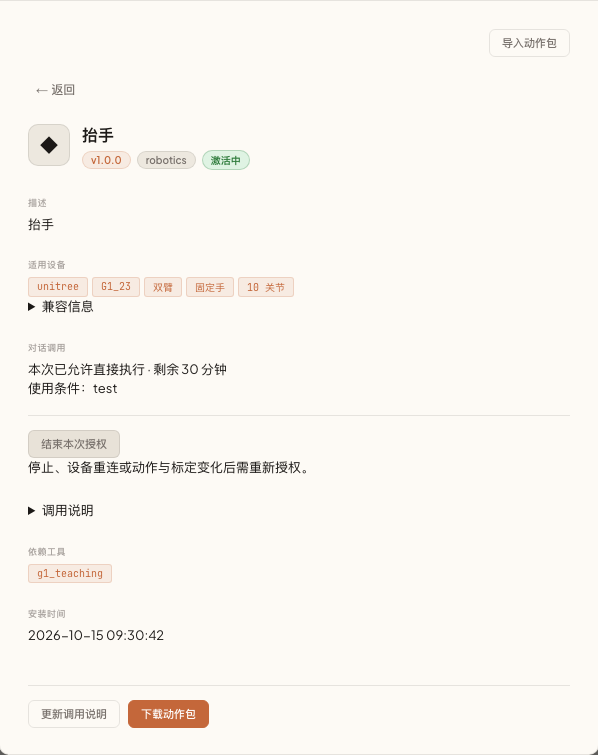

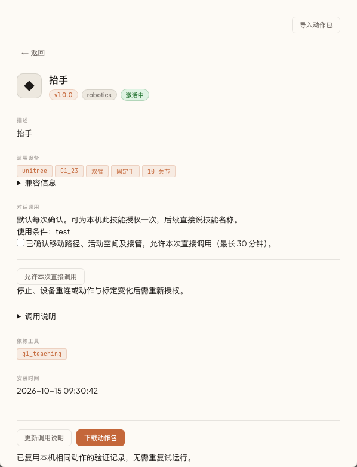

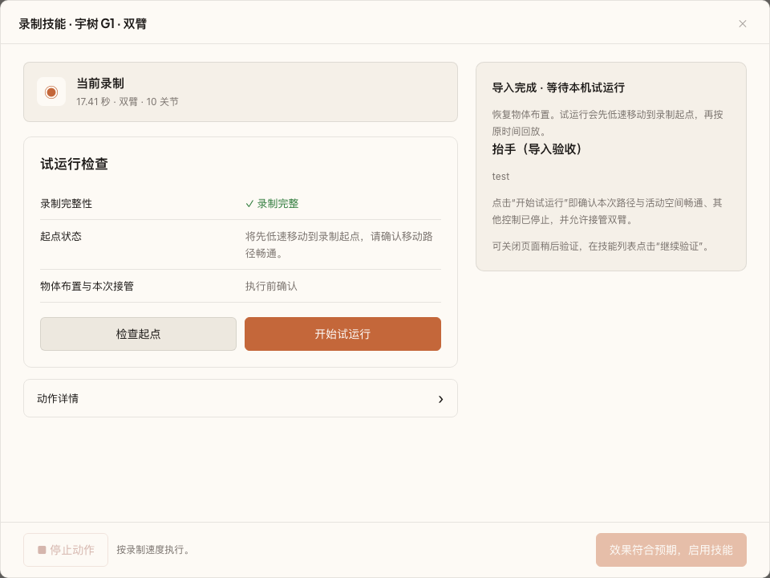

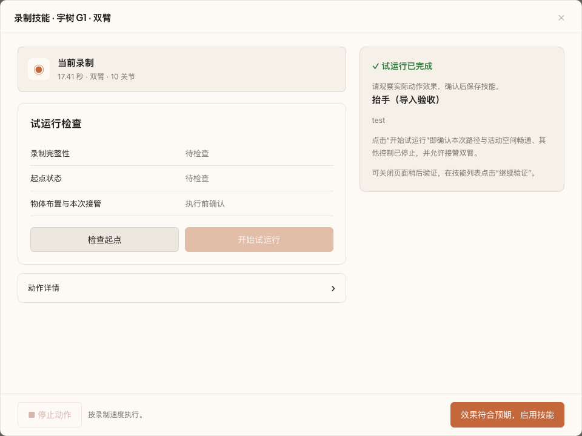

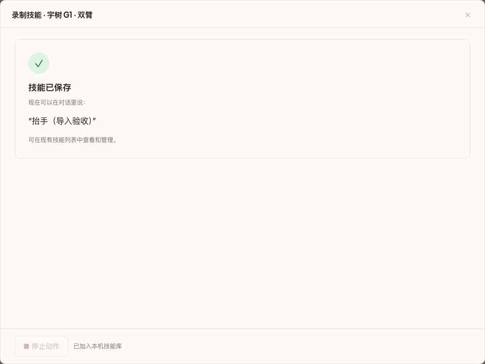

以上为上海真实 Core/G1 页面，无模拟 SDK/反馈；原技能使用条件为用户已有的 `test`，未替用户编造条件。未将实际轨迹、私有日志或凭据提交仓库。

本轮 Python 语法及 `git diff --check` 通过；新增正常子状态、其他模式和反馈间断的回归断言，按用户要求没有执行模拟测试。原厂 99 的 SDK 3104 根因、资源中心完整附件发布和多设备同名工具强制选择仍未解决。部署备份与私有实测回执在 `/opt/phanthy-motus/deployments/g1-release-20261016-b7eaec07/`。

## 网页端怎么使用

在当前设备绑定的 G1 Driver 中添加 `g1_teaching` 执行卡，将执行卡接入决策核心一次，后续生成的 Skill 沿用此连接。现场准备完成并点击「开启智能控制」后，选择卡片上的「录制技能」，点击原有「执行」。项目停止时，原网页会锁定执行按钮；本功能不改变此规则。没有新增全局按钮或专用 Web 服务。

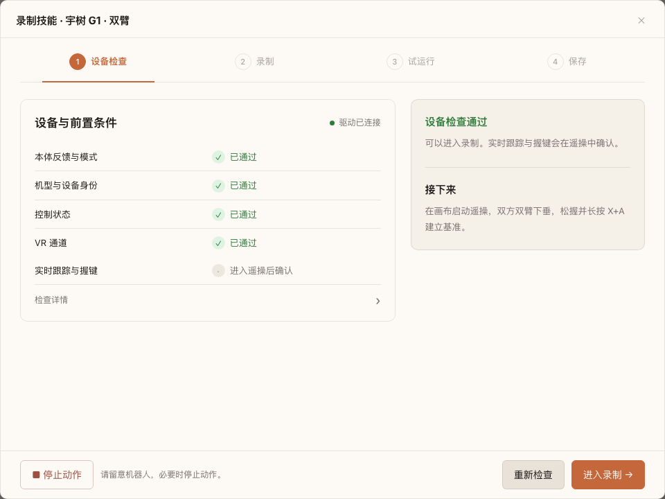

四项检查覆盖本体反馈与模式、机型与设备身份、控制状态、VR 通道。检查不申请运动权；通过通道检查后，仍需原控制器确认实时跟踪和基准。

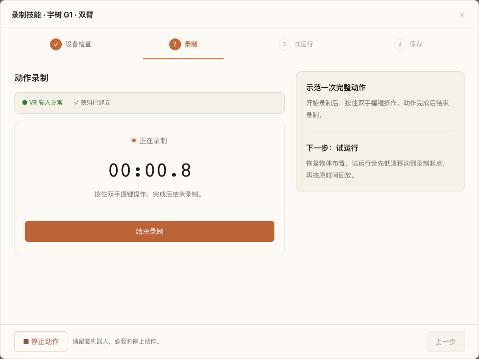

在原 Canvas 遥操连线启动后，由操作员松握、长按 X+A 建立基准。页面复用该会话，确认有效输入和可录制状态后开放「开始录制」。结束录制同时等待文件完成和原控制器停止交权。

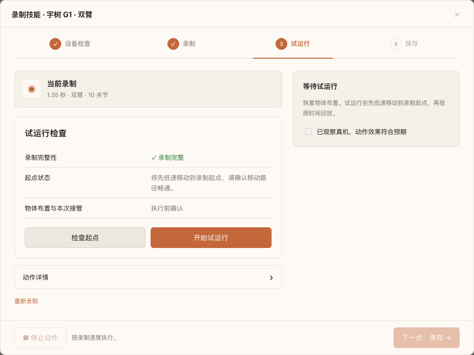

G1_23 是双臂 10 关节、固定假手。动作曲线默认收起；不显示 PiPER 夹爪或起点位置容差。试运行明确包含先低速移动到起点的过程，执行前确认路径和接管。

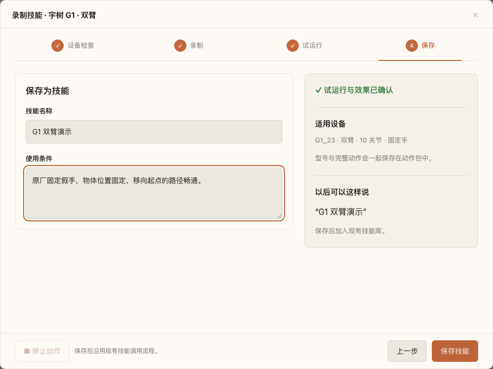

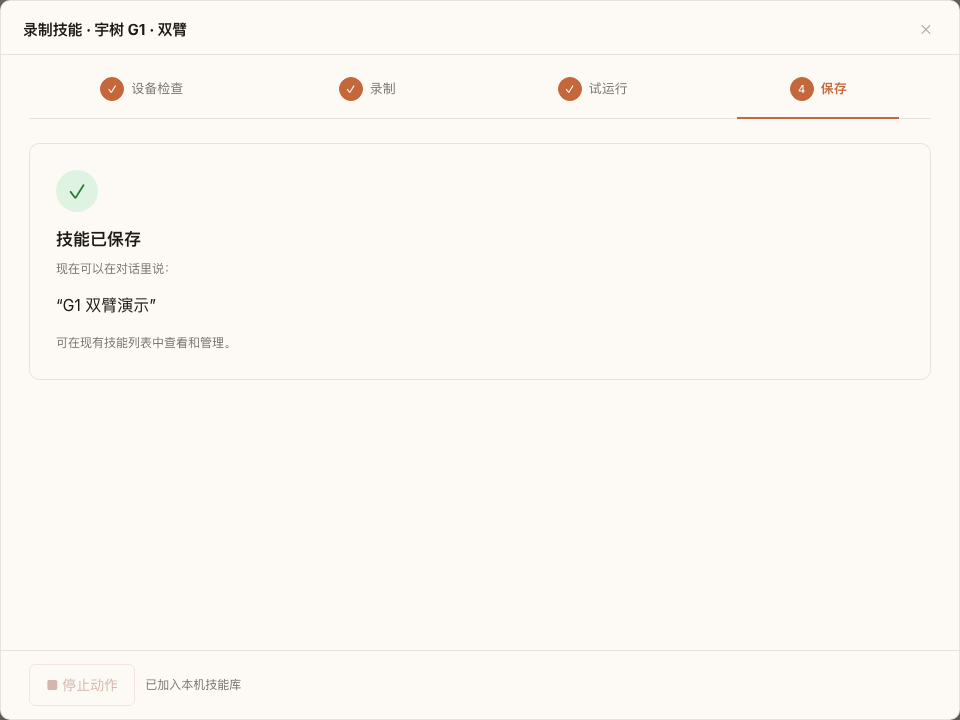

保存需要回放真实完成和用户确认效果。Driver 持久化轨迹引用、SHA-256、设备/模型/几何绑定及试运行结果；Core 导入普通 Skill，下一次对话可发现，由已有 `activate_skill` 加载指令，再调用当前 G1 服务的 `g1_teaching.run`。每次执行仍需新预览；没有有效会话授权时须确认本次条件，沿用原回放的 `action_id` 和 ACP 完成事件。

## 独立 G1 分支的改动范围

| 文件 | 用途 |
| --- | --- |
| `unitree/g1/teaching.py` | 将现有 G1 会话、录制、起点检查、回放和终态接到共享示教流程；短时单次预览与确认 |
| `unitree/g1/trajectory_control.py` | 增加两个可选内部检查参数，拒绝预览后文件变化、停止后旧请求再启动；原 filename-only API 兼容 |
| `unitree/g1/main.py`、`driver.yaml`、`Dockerfile` | 注册卡片、沿用本机来源限制、将适配器装入镜像 |
| `common/teaching/service.py` | 接受控制器已建立的会话，使用机器人资源声明、完成超时和回放说明 |
| `common/teaching/workbench.html` | 按机器人能力显示关节/夹爪、会话引导及起点行为；允许直接载入已有录制 |
| `tests/teaching_browser_support.py` | 独立通用浏览器测试辅助，不导入 PiPER 测试或夹具 |
| G1 测试和 README | 覆盖录制、失败阻断、执行取消、设备绑定、资产重载、浏览器保存与 Skill 调用，并提供实际截图 |

本分支以 G1 PR #330 的 `a6aa92de` 为基线，不包含 PiPER #395 / #402 的提交历史和驱动改动。公共模块单独提取自 #402，并针对机器人能力声明调整；两 PR 的共享路径需要在合并前协调。

配套 Core #318 提供通用工作台、本地导入、动作包传输和每动作必填参数声明。机器人检查与动作执行继续留在 Driver；单独升级 G1 Driver 不会使旧 Core 自动具备这些入口。

## 独立分支验证

拆分后重新执行 G1 回归：**139 passed, 3 skipped, 3 deselected**。跳过项为路径规则排除的两项 Dockerfile 自动收集和本机缺少 Pinocchio 的重力计算；三项原厂 SDK reset 在镜像中补测。示教测试显式检查 G1 Dockerfile 复制与导入路径。

独立浏览器测试 **1 passed**：从 G1 执行卡打开页面，检查、录制、试运行、保存到现有 Skill 库，经过提示词发现、`activate_skill` 和实际 MCP 再次回放成功。测试不再导入 PiPER 模块、测试或夹具。页面截图在拆分后重新生成；底层硬件为模拟，未调用真实 LLM。

```sh
PICO_DRIVER_ROOT=/path/to/pico-checkout PYTHONPATH="$PWD" \
uv run --python 3.12 --no-project --with pytest --with numpy --with scipy --with pyyaml \
python -m pytest -q \
  unitree/g1/tests/test_g1_teaching.py unitree/g1/tests/test_g1_trajectory.py \
  unitree/g1/tests/test_default_teleop_profile.py unitree/g1/tests/test_arm_stream.py \
  unitree/g1/tests/test_teleop_alignment.py unitree/g1/tests/test_teleop_servo_execution.py \
  unitree/g1/tests/test_teleop_reset.py tests/test_dockerfile_copies.py \
  -k 'not reset_sdk_request_uses_no_reply'
```

上海当前 G1 镜像内重新运行本独立分支：**41 passed**，覆盖 `test_g1_teaching.py`、完整 `test_teleop_reset.py` 和 Pinocchio 重力计算用例。测试容器禁用网络、只读、没有硬件设备或现场数据，底层反馈与 SDK 输出为模拟。

基于当前 `release.261014.71114c3` 镜像增量构建 `phanthymotus-g1-teaching:g1-only-20261015`（`db56788c2150`）。未从 ROS 基础镜像全量重建、未推送镜像仓库。浏览器复现命令和通用接口见[接入说明](../../common/teaching/README.md)。上述数量是拆分后重新执行的结果，不沿用之前合并分支的统计。

## 上海测试部署（2026-10-15）

已将独立 G1 功能提交 `d24ef579` 部署至上海设备，G1 使用上述候选镜像。Core 基于现场原 `release.261014.03ced4b`，仅应用 #318 的 `src/api/skills.py`、`web/js/canvas.js` 和新增 `web/js/workbench.js`，构建 `phanthymotus-core:workbench318-20261015`（`3864ad3baf5e`）。没有追加 G1 专用 Core 逻辑，也没有更新 PICO 镜像。

原 Compose 配置和一致性 SQLite 数据库已备份；使用原 Compose 项目及服务名，仅切换 G1/Core 镜像字段，保留网络、挂载及其他配置。现有 12 张卡保留，新增 `g1_teaching` 卡并连接决策核心，PICO → G1 的连线保留。

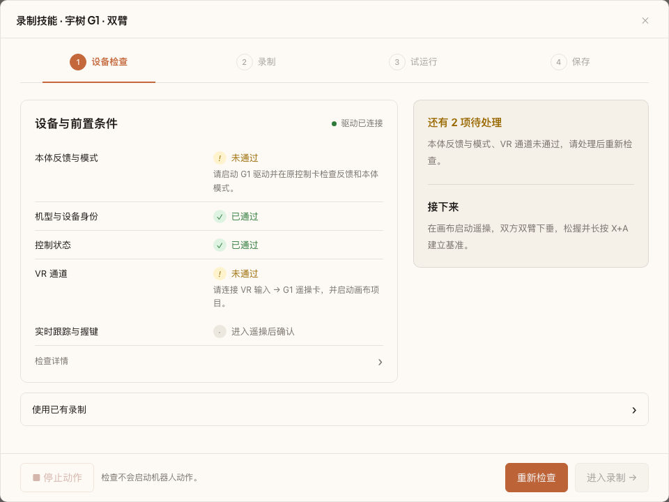

此图来自现场部署后的真实 Core 与 G1 服务，没有模拟反馈。为保持项目停止，浏览器通过已部署的通用宿主加载 `ui` 并执行只读 `check`；**它不代表已通过「开启智能控制 → 点击卡片执行」验收，也不代表录制或回放成功**。页面脚本无报错，未通过设备检查时「进入录制」保持禁用。

现场检查结果：机型/设备身份和控制状态通过；本体模式、VR 通道未通过。只读查询确认当前 FSM 为 0（零力矩），不满足原遥操配置允许的模式；Driver 重启后项目尚未启动，因此 VR 输入处于 `waiting_binding`。没有自动切换本体模式、启动项目或触发运动。

Core 候选镜像内 Skill 导入/API 测试 **14 passed**。现场确认工作台协议、MCP 代理和导入路由可访问（无效空导入返回 422，未添加测试技能）。录制、试运行、发布及真实 LLM 调用仍需现场验收。

设备上的备份与回滚脚本位于 `/opt/phanthy-motus/deployments/g1-teaching-20261015-pd1hh55u/`。项目停止且没有动作时可执行 `python3 <该目录>/deploy.py --rollback` 恢复原 G1/Core 镜像；该命令保留当前数据库和新增画布卡，避免覆盖后续用户数据。恢复旧镜像后应从画布移除不再支持的 `g1_teaching` 卡。

## 仍需现场验收

- 用户已反馈上海录制可用。2026-10-16 已部署调用修复和动作包；真实回放触发了结束交权超时，已单独修复并恢复预览。修复后完整物理回放及真实 Agent 的确认→执行→完成流程仍待现场验收，详见下方最新记录。
- 动作包导出及调用说明更新固定来源 MCP/卡片；Agent 在多个同名设备间的自主路由没有新增强制机制，仍由原连线选择和 Driver 设备/资产绑定兜底。
- 网页「运行技能」仍使用原参数表单；按名称选择技能并运行的便捷页面尚未实现。对话调用依赖已有语音或消息渠道。


## 调用修复与完整动作包（2026-10-16 已部署候选）

真实 Agent 的失败是执行调用漏传 `preview_id`，重试又漏传 `asset_id`；并非证据表明起点无法恢复。新增独立 `preview(asset_id)`，返回完整执行参数模板（两个确认字段默认 false）。`run` 必填资产、执行标志、预览编号和两项本次确认；缺参数不消耗有效预览，错误预览编号与超时分别报告。Skill 指令要求先询问并等待用户确认，再完整提交参数。布尔字段并不能证明确认一定来自人，真实 LLM 是否遵守仍需现场验收。

已保存的旧 Skill 在「我的 → 技能广场 → 已安装 → 技能详情」点击「更新调用说明」，从原设备校验原动作后更新参数说明和型号信息，保留启用状态及原动作。此操作不回放。机器人关机时无法读取原资产，需上线并更新配套版本后使用。

同一详情页可「下载动作包」；在「已安装」中「导入动作包」，选择目标设备卡片，随后进入现有工作台检查、试运行并确认效果。导入不会直接启用 Skill，也不会启动动作；试运行成功后保存才产生新的本机 Skill。

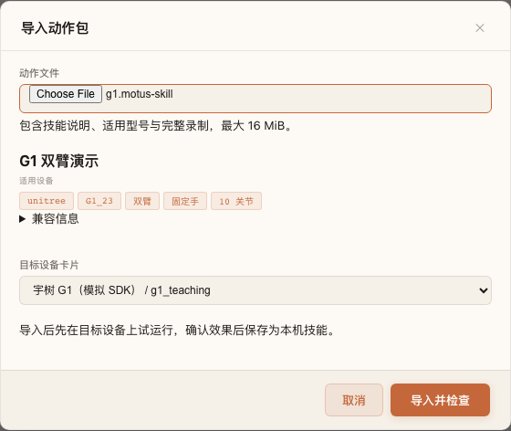

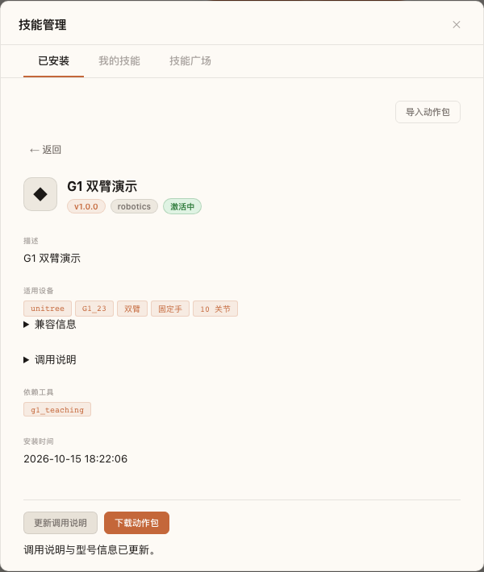

包格式为 ZIP，仅包含 `manifest.json`、`trajectory.jsonl`：完整录制与 SHA-256、名称/条件/触发语、Unitree/G1/G1_23、双臂 10 关节顺序、固定手、模型及几何摘要、profile ID/版本、录制协议及驱动能力。`driver_version` 是生成定义或导出时的镜像环境标签，缺失时为 unknown，不能追溯未知的历史录制版本。

导出移除原设备身份与控制会话；导入严格比较兼容字段（构建标签除外），用目标设备身份写入新的本机录制，清除原试运行授权。原始录制直接复制到另一台 G1 仍受原绑定检查阻止。传输限 16 MiB 压缩包、64 MiB 轨迹，按 24 KiB 分块；限制 ZIP 文件名、条目数、大小、压缩方式及 SHA，不解压任意路径或执行脚本。每张卡最多保留一个上传和一个下载临时传输，30 分钟到期后在下一次访问清理。

新增文件 `common/teaching/package.py` 负责文件格式和有界传输；`unitree/g1/teaching.py` 负责兼容检查和本机重新绑定；`test_g1_teaching_package.py` 覆盖跨设备、型号不符、损坏包、未试运行和草稿冲突。

### 资源中心的真实边界

2026-10-15 已查本地项目、已有 Git 历史、4paradigm 可见仓库/分支、当前账号可访问仓库及公开代码搜索，尚未定位 Resource Center 源码。当前 GitHub 账号没有返回组织成员关系；无法据此判定仓库不存在或具体属于哪个私有项目。

线上 `https://motus.phanthy.com/zh/skills?tab=mine` 的公开客户端使用 `/api/skills/mine`、`/{id}` 和 `/{id}/submit`，创建表单仅提交文字与配置 JSON，没有动作附件上传流程。此证据不能证明服务端不存在其他接口。本次没有虚构云端附件 API，也未上传测试技能。完整动作包目前支持本地下载与导入；广场附件存储、草稿绑定、审核、授权下载和安装衔接需要在资源中心实现，尚未完成。


### 2026-10-15 本地验证结果

- Core：`test_tool_schema_presentation.py`、`test_skill_import.py`、`test_skill_packages.py`、`test_mcp_registry_merge.py`、`test_mcp_call_errors.py`，**52 passed**。
- G1 示教、动作包、轨迹、arm stream 和 Dockerfile：**101 passed, 3 skipped**。两个跳过是 worktree 自动收集规则，一个是本机无 Pinocchio；显式 G1 Dockerfile 检查通过。
- 补充“缺失机型配置仍可打开检查页”后，最终示教与动作包测试 **20 passed**；与上一项重叠，不累加。
- 最终网页流程 **1 passed**，覆盖技能详情、更新旧调用说明、完整下载、另一设备身份导入、未试运行不可保存、重新试运行/确认/保存；与动作包用例合跑为 **5 passed**。实际 LLM 和真机未验证。
- 将 G1 共享模块临时接到原 PiPER #402 适配器的额外检查为 **9 passed, 6 failed**，缺失 `presentation` / `replay_instruction` 接口。用更新前的 G1 HEAD 再现同一 `presentation` 失败，属于原有合并边界，未修改 PiPER PR 或文件。共享模块合并前必须在独立 PiPER 适配中补齐声明并重新回归，不能据此声称两边已兼容。

失败的错误注入包故意写入重复 ZIP 文件名，pytest 的一条重复文件名 warning 来自这个负面用例。

## 上海部署与占用修复（2026-10-16）

Core 基于现场 `release.261015.0897a8d` 应用 #318 的完整增量，构建 `phanthymotus-core:workbench318-20261016`（`0609067d81ce`）。保留现场基线的 MCP 更新，未用旧分支整文件覆盖。实际候选镜像内五组 Core 回归 **52 passed**。

G1 容器存在 `/home/unitree/work:/work` 挂载，因此镜像标签仍为 `phanthymotus-g1-teaching:g1-only-20261015`；实际更新的是宿主挂载代码。先部署 `teaching.py` 与三个 `common/teaching` 文件，再补充本节的 `arm_stream.py` / `teleop_control.py` 修复并重启 G1。未更新 PICO、其他驱动，也未覆盖现场 `main.py` 中其他卡片的注册。原画布已缺少示教卡，在保留现有卡片和连线后补回 `g1_teaching` 及决策核心连接。

### 真机发现与修复

现场确认路径、空间和接管后，只执行了一次已保存“抬手”（录制 17.4096 秒、250 帧）。用户反馈机器人已动作；驱动记录全部轨迹帧结束，但最终状态为 error，不能记为整次验收通过。

现场状态是五次零权重写入完成、`handback_confirmed=true`、随后重复的静止确认超时。旧逻辑保留 unknown 操作和会话，导致真实 Agent 正确调用 `g1_teaching.preview(asset_id)` 仍收到 `motion_busy`；随后过期的 replay watchdog 又覆盖了直观错误原因。

本轮仅修改两处 G1 生产文件，无新增 Core 逻辑：

- `arm_stream.py`：普通 stop 无后续原厂动作时，已有的零权重交还和新鲜静止确认直接完成；接受交还时撤销回放计时。纯停止超时后，仅在零权重写入已确认、无 SDK 动作/在途请求且再次获得新鲜静止反馈时解除占用，不重发动作或轨迹。
- `teleop_control.py`：优先报告 release 操作的实际错误，避免被后续 hold 原因掩盖。

不放宽速度/位置阈值，不清除未知原厂动作结果，不把“超时”当完成。回归覆盖重复 stop、迟到反馈、运动/陈旧反馈阻断、未完成零写入及 SDK 动作未知仍保留占用。

现场相同 G1 镜像中的隔离测试容器执行 `test_arm_stream.py`、`test_teleop_reset.py`、`test_teleop_servo_execution.py`、`test_g1_trajectory.py`、`test_g1_teaching.py`、`test_g1_teaching_package.py`：**144 passed**（120.11 秒）。容器禁用网络、不挂载设备，SDK/机器人反馈为测试替身；该数量不是 144 次真机动作。先前本机运行因漏设测试路径以及缺少 CycloneDDS 导致环境失败，最终以具备 SDK 依赖的隔离容器完整结果为准。

现场先通过原 stop 的显式 retry 完成了同一停止目的的零权重交还：`physical_confirmed=true`、`authority_released=true`，没有请求原厂动作。确认空闲后才更新并重启 G1。重启后多次预览成功，`busy=false`，没有第二次运动。**这证明占用已恢复，尚不证明修复后完整物理回放通过。**

### 真实网页验证

在部署后的网页「我的 → 技能广场 → 已安装 → 抬手」完成更新调用说明和下载完整动作包，原 Skill 仍启用。型号显示 G1_23、固定手、双臂 10 关节。下载文件 38,828 字节，包含 199,533 字节的导出轨迹，ZIP/manifest/SHA 校验通过。动作包选择页能读取型号和找到目标设备，技能数量不变、页面无脚本错误。此现场检查未执行导入后的物理试运行；真实轨迹文件不提交到仓库。

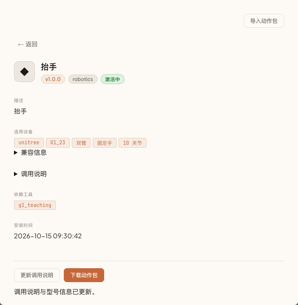

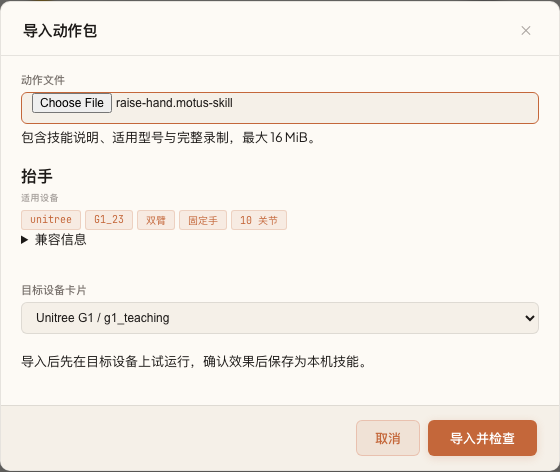

备份位于设备 `/opt/phanthy-motus/deployments/g1-teaching-20261016-0cbc1409/`，包含部署前 SQLite、G1 数据、源文件和容器记录。项目停止且设备空闲时，`python3 <目录>/rollback-release-fix.py` 可恢复本轮两处停止逻辑；若要完整回退，再执行 `python3 <目录>/deploy.py --rollback`。回滚保留当前录制、数据库及画布，不自动恢复旧数据。镜像未推送远端仓库。
