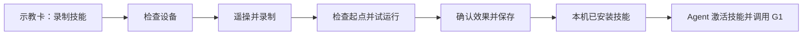
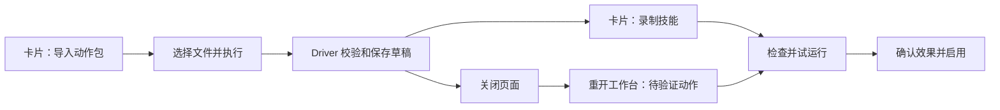

# G1 遥操录制技能使用说明

更新：2026-10-27。本页对应 [Driver #412](https://github.com/4paradigm/phanthymotus-driver/pull/412) 的审核修改；已适配合并后的 Core。实机验证记录：2026-10-19 的 `a335e68c` 接口修改版本已完成 G1 实机验证。

## 先分清三件事

- **G1 示教卡**：负责连接当前设备的录制、检查和回放能力。
- **技能**：保存到当前 PhanthyMotus 的动作名称、使用条件和调用说明。Agent 找到它后，通过 G1 示教卡调用动作。
- **动作包**：包含完整轨迹和适用型号的文件，用于导入。只把文字技能上传到广场，不会自动把机器人里的轨迹一起带过去。

## 录一个动作，保存成技能

1. 打开这台 G1 绑定的 PhanthyMotus 网页。画布上已有 PICO → 遥操卡连线；将 `g1_teaching` 执行卡连到决策核心。
2. 现场准备完成后开启智能控制，在 G1 示教卡选择「录制技能」，点击原有「执行」。没有新增全局示教按钮。
3. 点击「检查设备」。页面检查本体反馈、机型与设备身份、控制状态、VR 通道；检查不会启动动作。按失败项提示处理后重查。
4. 按原 G1 遥操方式建立基准：人和机器人双臂下垂、松开握把，长按 X+A 至少一秒。页面显示可以录制后，点击「开始录制」，按住双握把示范，松握暂停。完成后点击「结束录制」。
5. 检查起点及现场布置，执行试运行。机器人会先低速移到录制起点，再按原时间轴回放。页面显示完成后，确认实际效果符合预期。
6. 填技能名称和使用条件，点击「保存技能」。保存后可在「我的 → 技能广场 → 已安装」找到，在现有 Agent 对话中说出技能名称调用。

动作详情默认收起，不必看关节曲线才能使用。保存得到的是录制动作回放，物体和环境布置变化后不能当作具备视觉定位的技能使用。

## 不想每次对话都确认，在哪里设置

三个入口都只影响当前技能：

| 场景 | 操作 |
| --- | --- |
| 刚录完，准备保存 | 勾选「保存后允许自动执行」 |
| 导入并试运行通过，准备启用 | 勾选「启用后允许自动执行」 |
| 已经保存的技能 | 我的 → 技能广场 → 已安装 → 技能 → 对话调用 →「允许自动执行」 |

设置默认关闭，开启后停止项目、重启容器仍保留。驱动每次执行仍检查录制、设备、起点、反馈和资源占用。换设备或录制后不会继承权限。

**新版没有“整卡所有动作自动执行”开关，也没有 30 分钟授权。** 如果旧版只开过卡片总开关，升级后需要到要使用的各技能详情分别设置；旧总开关不会自动变成所有技能的权限。旧技能调用说明可点「更新调用说明」刷新，此操作不执行动作。

## 导入别人给的动作包

1. 在目标 G1 的示教卡，把动作改为「导入动作包」。
2. 点击文件选择器，选择 `.motus-skill` 或 `.zip`，上传完成后点「执行」。网页会把文件送到这台 G1 的 Driver。
3. 导入成功只表示文件和型号检查通过，机器人还没有动作。把卡片动作切回「录制技能」，点「执行」打开工作台。
4. 检查现场和起点，点击「开始试运行」。该按钮旁明确说明了路径、空间和接管条件，不再额外弹一层相同确认。
5. 等待完成，观察实际效果后点击「效果符合预期，启用技能」。

关闭页面后，在同一张卡重开「录制技能」，展开「待验证动作」，选中草稿并点击「继续验证」。Driver 重启后草稿仍在，但尚未保存的试运行结果要重新验证。

同一设备已经有完全相同的已验证动作时，可复用验证。技能已安装就直接用现有技能；系统不会覆盖用户改过的同名标识定义。

## 导出和上传广场，目前能做什么

卡片「导出动作包」需要填写技能的 `asset_id`，执行后返回完整包在 **Driver 容器里的路径**，位于 `skills/exports/`。目前没有浏览器一键下载入口；需要管理员从设备取出这个文件，再交给目标设备按上面的流程导入。

**本 PR 没有完成技能广场的完整动作附件发布闭环。** 只发布文字 Skill 不能让另一台机器人拿到轨迹。Core 已有通用技能附件能力，但本次没有新增资源中心对接，也没有把本机资产引用假装成可跨设备安装的包。

## 页面参考与历史证据

以下截图来自 10 月 15–16 日旧版，展示保留的检查、录制、试运行和保存页面布局；**不是本轮新截图或新验收结果**。本轮新增的「待验证动作」折叠区不在这些截图中。旧专用导入弹窗、整卡开关和继承状态已删除，不能照旧图操作。

完整旧版实机记录见 [历史开发与验收](g1-history-20261016.md)。团队之前拿到的 10 月 16 日 PDF/Word 同样属于旧版，入口变更以本页为准。

## 对应 PR 与本轮验证

| PR | 内容 / 状态 |
| --- | --- |
| [Driver #412](https://github.com/4paradigm/phanthymotus-driver/pull/412) | G1 示教、动作包与本轮审核修改 |
| [Core #318](https://github.com/4paradigm/phanthymotus/pull/318) | 通用工作台和普通 Skill 安装，已合并 |
| [Core #334](https://github.com/4paradigm/phanthymotus/pull/334) | 通用文件/技能接口整理、删除专用分块与整卡策略，已合并 |
| [Driver #417](https://github.com/4paradigm/phanthymotus-driver/pull/417) | 各 Driver 的通用文件上传，已合并，已同步到本分支 |
| [Driver #402](https://github.com/4paradigm/phanthymotus-driver/pull/402) | 独立的 PiPER 示教 PR，不是 G1 PR 改号 |

本轮基于 Core main `6df601f` 检查文件格式、通用上传、真实 HTTP 文件转发、逐技能策略与资产身份：**72 passed**。Python / JavaScript 语法和 diff 检查另行执行。本轮未运行模拟机器人验收。

实机验证状态已确认：2026-10-19 的 `a335e68c` 接口修改版本已完成 G1 实机验证。10 月 16 日的“抬手”“右手挥手”记录仍作为对应旧版本的历史记录保留。部署时保留录制与资产目录、设备身份挂载和 `FASTRTPS_DEFAULT_PROFILES_FILE=/opt/phanthy-motus/dds-local.xml`。

开发接口、校验规则和测试命令见 [通用示教模块说明](../../common/teaching/README.md)。
