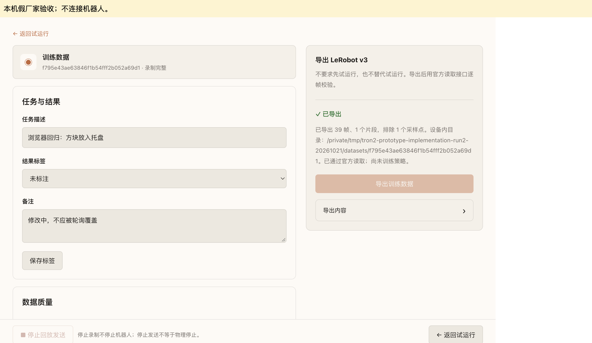
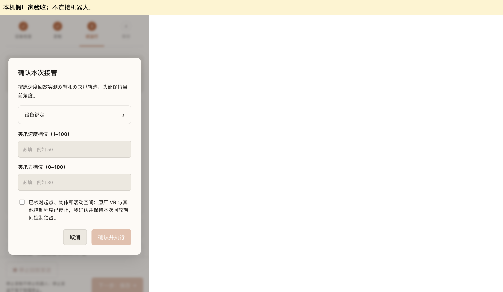

# TRON2 原厂 VR 录制、回放与 VLA 导出

`tron2_teaching` 使用 G1 teach 的公共工作台和动作包服务。录制器只发送关节和夹爪查询，并读取三路 MJPEG。开始录制、停止录制和保存训练数据均不发送运动命令，不进入或退出原厂 VR。

Core 必须包含工作台托管与卡片动作过滤（Core 提交 `b00075b0`）。卡片 ACTION 显示录制技能、运行技能、preview、恢复原位（reset）、动作预设参数（parameters）、导入动作包、导出动作包；数据质量、标注和训练导出位于工作台内。旧 Core `release.261014.03ced4b` 会显示所有内部动作，不能只更新 Driver。

试运行由操作者确认独占。执行前退出原厂 VR，停止其他控制程序，核对起点与活动空间，并在确认弹窗中勾选确认。已保存技能可使用Core原生的按技能自动执行设置；驱动每次读取当前设备、卡片和动作绑定对应的设置。自动执行已启用时，调用预览后直接执行，不再逐次询问；未启用时保留本次确认。软件不检测其他进程是否重新接管；操作者须在回放期间保持独占。

成功试运行的夹爪速度和力保存为该动作的 `execution_parameters`。日常调用使用动作预设；用户明确给出的 `gripper_speed` 或 `gripper_force` 仅覆盖本次，零力是有效值。保存技能界面默认勾选TRON2技能的自动执行，并显示将保存的参数；操作者可以取消勾选。旧技能没有预设时，用 `parameters` 一次性补齐已确认的值，再在技能详情启用自动执行。`parameters` 不执行运动。修改预设会使原自动执行绑定失效，需要重新启用；临时覆盖不修改预设或原试运行证据。

## 数据来源

双臂录制值允许超出当前厂家命令限位最多 5°。回放预检将容差内的值限幅到原命令范围，起点检查与后续发送均使用限幅后的目标；超过容差则拒绝整段。原始录制、训练数据与动作包导入导出保留实测值。直接 MoveJ/ServoJ 命令不放宽限位。

## 回放执行规则（原厂 SDK）

### 职责划分

回放由原厂 SDK 执行。本工具只负责启动、停止和确认结果，不自行发送 Driver ServoJ 指令，也不做 8 度跟踪、发送历史或自建 ACK 队列。原厂 `tron2_env` 固定在提交 `d38b6258f4c5a9607a231da1771e96cd1bdbccec`（Apache-2.0）。

### 数据与限幅

- 原始录制和动作包始终不变。
- 5 度边界容差只作用于执行副本的限幅。
- MoveJ 起点取厂家范围的交集，与录制值最多相差 2 度。

### 预览与执行

- 预览只读，不启动 SDK；进入执行后才启动 SDK。
- 执行前仍需预览，并通过数据校验、当前执行设置及同进程任务互斥检查。试运行和未启用自动执行的技能须确认本次接管。

### 起始准备

1. SDK 原厂初始化，过程中可能经过中间姿态。
2. MoveJ 到首帧，用时 2 秒。
3. 头部保持执行开始角度 1 秒。
4. 夹爪张开到 100，再恢复到首帧夹爪值。夹爪速度和力使用用户明确填写的值。

该过程不能称为低速，也不保证路径无碰撞。

### 回放发送

保持录制的原始时间戳，逐个目标调用 `command_joints`，并以原相邻间隔作为 `eta`。SDK 以 300Hz 插值并发送。

### 失败与停止

- 运行中出现 SDK 警告、错误或断线，任务即判为失败，不重连，也不续播。
- 停止请求会通过事件拦截后续发送，然后调用 SDK `pause` 和 `disconnect`。不会把取消后台线程当作停止。
- 若物理停止未确认，界面继续显示"未确认"并保持占用，可使用现有只读解锁。

### 结束智能控制时复位

卡片收到 `start` 后，首次生命周期 `stop` 会异步结束录制和回放，再调用官方 SDK 复位。双臂目标来自设备已有 `home.json`，头部回正，双夹爪闭合；夹爪使用官方 SDK 默认速度100、力档位50。SDK初始化仍可能经过中间姿态并先张开夹爪。复位期间拒绝重新启动或其他教学动作；未确认前一动作停止时不开始复位，失败写入Driver日志。

未经过卡片启动的工作台停止只取消动作。重复收尾不会再次发起复位。不修改 Agent Core，不增加工作台操作；操作者直接观察机器人。Core收尾提示表示请求已经返回，不是物理复位完成证明。

智能控制可调用公开 `reset` action，无需结束智能控制或选择录制资产。不传 `execute=true` 时只读预览目标；执行时须明确 `workspace_clear=true`、`take_control=true`、`exclusive_control_confirmed=true`。目标及SDK参数与收尾复位一致。录制、回放或收尾仍在进行时拒绝复位。返回 `running/action_id` 后，通过既有ACP报告实际终态；`info.last_action`可读取相同编号的结果，不能把请求受理当作到位。

### 完成判定

全部帧提交后，最多等待 8 秒新鲜反馈，需同时满足以下条件：

- 双臂和头部误差 ≤ 2 度，夹爪误差 ≤ 3 单位。
- 两路时间戳都在推进，接收年龄 ≤ 100ms。
- 连续满足至少 0.5 秒，样本间隙 ≤ 100ms。
- 窗口内关节极差 ≤ 0.2 度，夹爪极差 ≤ 1 单位。

不用相邻样本的位置差估算速度，因为量化会导致误报。只有结果观察和 SDK 清理都成功，任务才算完成。

### 边界说明

- SDK 已停止输出，不代表硬件已立即停止。
- 独占确认不是硬件租约。


2026-10-21 在指定 TRON2 上执行有界只读查询，每类 50 次、目标周期 20 ms；每路相机读取 20 帧。它们是独立短采样，不是原厂 VR 示教验收。

| 数据 | 已确认接口与顺序 | 单位和时间 | 短采样结果 |
| --- | --- | --- | --- |
| 双臂、头部 | `request_get_joint_state`；左 7、右 7、头 pitch/yaw | q 为 rad；dq/tau 原样保留；原始 timestamp 的时钟定义未验证 | 47.81 Hz，16 项；names 为空，按官方 SDK 索引绑定 |
| 双夹爪 | `request_get_limx_2fclaw_state`；left/right opening、speed、force | 开口为厂家 0–100 无量纲反馈；不使用未标定毫米值；timestamp 原样保留 | 47.96 Hz，两侧开口反馈可读 |
| 头部 RGB | `/camera/top/color/image_raw/compressed`，厂家端口 59001 | JPEG；只确认接收时间，未取得曝光时间 | 640×480，31.33 Hz |
| 左腕 RGB | `/camera/left/color/image_rect_raw/compressed` | 同头部 | 848×480，31.58 Hz |
| 右腕 RGB | `/camera/right/color/image_rect_raw/compressed` | 同头部 | 848×480，30.03 Hz |
| 原厂控制目标 | 已确认的状态、关节和夹爪查询未提供目标 | 不以实测反馈冒充原厂目标 | 未确认，保存为 null |
| 控制独占 | 只有模式、健康状态及本进程互斥 | 不足以证明其他进程停止 | 操作者逐次确认并保持独占 |

机上当时运行另一个 `0.10.1-recording-local` 版本，提供 16 关节录制及显示骨架回放。本轮未覆盖、部署或重启该服务。旧自研 `limx/tron2_teleop` 代码及 PR #397 保留，不由新卡片启动。

## 保存内容

默认容器目录为 `/data/tron2-teaching`，可通过部署配置中的 `TRON2_TEACHING_DIR` 指定。部署片段新增独立可写数据挂载，原 home 配置仍只读。

每个 `episodes/<id>/` 保存：

- `manifest.json`：`motus.tron2.episode/1`、设备序列号、固件、URDF SHA、关节顺序、单位、任务、结果、备注、来源与质量。
- `trajectory.jsonl`：关节 q/dq/tau、双夹爪原始反馈、源时间、接收单调时间、接收墙钟时间、序号及原厂目标可用性。
- `head.mjpeg`、`left_wrist.mjpeg`、`right_wrist.mjpeg`：原始 JPEG 包按接收顺序连接，不重新编码。对应 `.jsonl` 保存逐帧序号、时间、字节位置和长度。
- `complete.json`：在所有文件 fsync、清单写入及目录同步之后写入；绑定清单 SHA。清单包含各数据文件的大小和 SHA256。

写盘线程使用有界队列，磁盘余量至少 256 MiB，最长 30 分钟，轨迹上限 64 MiB。溢出、时钟倒退、相机断流或关节断流结束录制并保留失败数据，不自动删除。重复源时间的关节样本不重复写入。三路图像或夹爪缺失时，不能标记为完整训练 episode。

源时间未验证，首版统一在同机单调接收时钟上对齐。不声称曝光同步或硬件同步。

## 工作台和训练导出

1. 在卡片打开工作台并检查设备。
2. 点击“开始录制”，在弹窗填写任务描述。确认后开始只读录制，再使用原厂 VR 示范。
3. 结束录制后进入试运行页。展开“训练数据”，点击“打开训练数据”进入独立页面。
4. 查看质量，补充成功、失败或未标注结果与备注，点击“保存标签”。随后可直接导出 LeRobot v3，不要求机器人回放。

主流程固定为“设备检查 → 录制 → 试运行 → 保存”。训练数据页面提供返回入口。历史录制中的“查看数据与诊断”也打开此页面。未完成录制只显示诊断，禁用标签保存和训练导出。

试运行前在弹窗填写夹爪速度与力档位，并勾选独占确认。每次打开弹窗都会清空夹爪参数；空值或无效值不会关闭弹窗。

实际浏览器界面示例（本机假厂家数据，不是现场验收）：





固定使用官方 `lerobot==0.4.4`（Apache-2.0）的 `LeRobotDataset.create/add_frame/save_episode/finalize` 和读取接口，输出 H.264 三路视频。导出完成后逐帧读取并解码三路图像，检查 state/action 形状和归一化统计。失败目录保留，已有目录不覆盖。

- `observation.state` / `action`：左 7、右 7、左夹爪、右夹爪；前 14 项 rad，后 2 项厂家无量纲开口。
- 当前真实采集使用 `measured_future_state`：10 Hz 训练帧的下一时刻实测状态作为绝对动作，派生间隔 0.1 秒。末尾没有未来状态时不生成动作。
- 图像选择当前时刻之前最近的帧，最大误差 50 ms；关节只在间隔不超过 100 ms 的相邻样本之间插值。夹爪使用最近过去值，不插值。
- 无效点排除，缺口两侧分成独立训练 episode；不压缩时间后拼成一条运动。
- `observation.head`、`source_time_ns`、`action_time_ns`、结果标签和任务保留在数据集；原始时间、来源和所有 episode 校验信息保存在导出报告及原 episode。
- 数据集目录对应一个来源 episode，只有一个动作来源；不混合派生动作和原厂目标。成功读取不证明训练效果。

也可离线运行：

```sh
python3 -m pip install -r limx/tron2/requirements.txt -r limx/tron2/requirements-vla.txt
python3 limx/tron2/vla_export.py /path/to/episodes EPISODE_ID /path/to/new-dataset
```

## 与 G1 teach 的界面关系

复用 PR #412 固定版本的同一工作台页面和草稿/试运行/效果确认/Skill 保存服务，不是逐项完全相同的界面。

| 流程 | G1 teach | TRON2 |
| --- | --- | --- |
| 检查与录制 | 检查、启动 G1 遥操/映射、录制 | 检查、由用户启动原厂 VR、只读录制 |
| 录制后 | 试运行 | 试运行；折叠入口打开独立训练数据页面 |
| 动作保存 | 试运行成功、人工确认效果、保存 Skill | 相同约束 |
| 导入动作包 | 导入待验证、试运行、确认启用 | 相同约束；试运行前增加夹爪参数和独占确认弹窗 |
| 新增内容 | 无 TRON2 数据集字段 | 任务/结果/备注、三路图像质量、LeRobot 导出 |

训练导出不替代动作试运行。停止录制不停止原厂 VR。自动执行仅适用于已验证并启用该设置的技能，不授予导入文件或未验证动作执行权限。

## 回放与动作包

轻量回放使用 `motus.tron2.trajectory/1`，不复用 G1 十关节 schema。外层动作包仍是原有两文件 ZIP，不含视频；训练导出直接读取完整 episode。

回放执行器校验文件、模型和设备绑定、关节限位及时间连续性。起点准备、执行和完成判定按本页“回放执行规则”执行。SDK 保持头部开始角度，使用用户填写的夹爪速度和力档位。回放与本进程的其他运动任务互斥；失败后不自动续播。

每次回放都需要新的预览；未启用自动执行时需要本次独占确认。真实试运行成功且用户确认效果后才能保存 Skill。导入动作包只创建待验证草稿；不能通过包内声明绕过本地试运行、效果确认或本机自动执行设置。

## 验证入口与边界

```sh
python3 -m pytest -q limx/tron2/tests tests/test_teaching_package.py tests/test_file_upload_endpoint.py tests/test_dockerfile_copies.py
python3 tests/serve_tron2_teaching.py --root /private/tmp/tron2-browser-test
bash build.sh --mirror none limx/tron2
```

浏览器 fixture 只监听本机 15892，使用真实工作台、HTTP 和文件实现，厂家与相机为假服务。它不是 Core 部署或现场验收。使用新数据目录启动 fixture 后，在其浏览器页执行 `tests/teaching_workbench_browser.js`。脚本返回 Promise，覆盖任务必填、标签保存、轮询保护、官方训练导出、回放参数、技能保存及断流诊断；必须先安装 VLA 依赖。脚本只允许本机 fixture 页面，不能用于机器人页面。

2026-10-23 原678帧通过生产Driver回放，用户已确认主流程。真实录制导出131帧，并通过官方LeRobot ACT两步训练、保存和重载推理。两步训练仅验证数据与训练链路，不代表策略效果。收尾复位已取得现场到位回执；Core提前显示完成的问题仍未修复。依赖中的 torchvision 视频解码接口给出弃用提示；固定版本目前通过测试，升级官方依赖时须重新验证。
