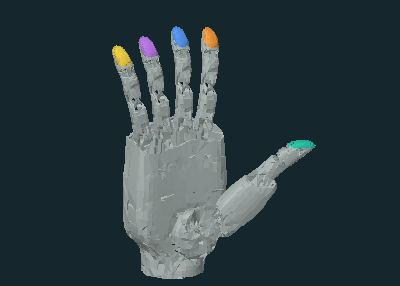

# L20 轨迹仿真

本卡使用厂家的 G20 模型，对应本文板上验收的 LinkerHand L20-10。仿真服务提供与实手隔离的 `hand_gesture`、`hand_grasp` 实例和 `l20_mujoco`。在「L20 仅仿真」服务里选择卡片。每个实例在配置里选左手或右手；同侧的两个动作输出可以同时连入一个模拟实例。抓取使用当前驱动的空载收拢控制器，手势复用手势和数字的目标及避碰过渡。参数仅影响虚拟手。

启动已连好的实例，执行上游的手势、准备、空手收拢或张开。模拟手播放期间拒绝后来动作。点击模拟卡「查看数据流」在画布内显示实时 JPEG。执行 `view` 打开可旋转的三维工作台，切换实时与回放；支持 1×、0.5×、0.25× 和逐帧拖动。每个实例保留最近一个完整动作；中止动作不会覆盖它。实时画面和回放按同一配色标示五根手指末节掌侧的触觉区，工作台内附图例。着色边界按厂家网格的指腹外形估算，颜色用于识别手指。工作台显示运动学姿态，不提供物体、接触或力传感模拟。

## 接入其他轨迹来源

上游通过画布声明 `topic_out` 格式 `data/l20_joint_trajectory`，消息类型 `std_msgs/msg/String`，可靠传输。模拟卡的 `start` 接收画布传入的单个 `input_topic` 或多个 `input_topics`；只有已连接的话题参与。每个消息携带一次完整且有序的轨迹。以下为一帧的最小例子。

```json
{"schema":"motus.l20.trajectory/1","id":"example-1","side":"right","action":"open","frame_ms":50,"frames":[[255,255,255,255,255,70,200,132,55,0,255,255,255,255,255,255,255,255,255,255]]}
```

`id` 每次动作唯一；`side` 为 `left` 或 `right`，需与接收实例一致。每帧按 L20 的五个指根、五个侧摆、拇指旋转及四个保留位、五个指尖排列，共 20 个 0–255 整数。每次允许 1–600 帧，固定帧间隔为 20–1000 毫秒。第三方 DDS 发布者可以在模拟卡 `info` 的 `rejected` 查看最近一次拒绝原因。及时读取该字段；下一次接受的动作会清除它。



## 构建与部署

在仓库根目录运行 `bash build.sh --mirror none linkerhand/l20_mujoco`，生成独立的 Linux ARM64 仿真镜像。实手使用 `linkerhand/l20`。离线板子可以加载已构建的同一镜像：在联网机器上用 `docker image save -o l20-mujoco.tar <镜像名:标签>` 导出，在板上用 `docker image load -i l20-mujoco.tar` 导入，并沿用[部署配置](../../l20_mujoco/deploy/service.yml)。

仿真服务在本机 `127.0.0.1:15769/mcp` 提供 MCP，ROS 2 使用域 42。部署配置以只读方式挂载平台提供的 `/opt/phanthy-motus/dds-local.xml`，与 Agent Core 使用同一回环传输。启动前需确保该文件存在、非空且可读。Docker 的 `local` 日志驱动使用 `max-size=10m`、`max-file=3`。容器不挂载硬件设备，仿真进程禁止创建 CAN 和原始链路套接字。

### 镜像依赖与大小

使用本目录对应的固定 ROS 基础镜像，在同一 Linux ARM64 构建环境中以 `docker image inspect --format '{{.Size}}'` 测量。以下为十进制 MB，实际数值随基础镜像和传递依赖变化。

| 镜像 | 大小 | 相对 ROS 基础镜像 |
| --- | ---: | ---: |
| ROS 基础镜像 | 261.6 MB | — |
| L20-10 仿真镜像 | 295.3 MB | +33.7 MB |

仿真复用基础镜像中的 NumPy 1.21.5、PyYAML 和 ROS 2。额外的 MuJoCo 3.2.7 用于关节运动学，Pillow 11.3.0 用于生成实时 JPEG。实手专用的 python-can 只需装在实手驱动中。独立镜像使实手驱动可以单独部署，不承担仿真引擎和模型的体积。

左右手的网格、URDF 和标定表来自[厂家 G20 模型包](https://urdf-view.linkerbot.cn/api/v1/urdf-models/10/download)，压缩包约 16.3 MB，构建时和加载时均校验 SHA-256。源码与许可见[模型来源说明](../resource/SOURCE.md)。已有项目 COS 镜像地址时可在 Docker 构建中传入 `--build-arg L20_MODEL_URL=<镜像地址>`；校验值与厂家原包相同。
