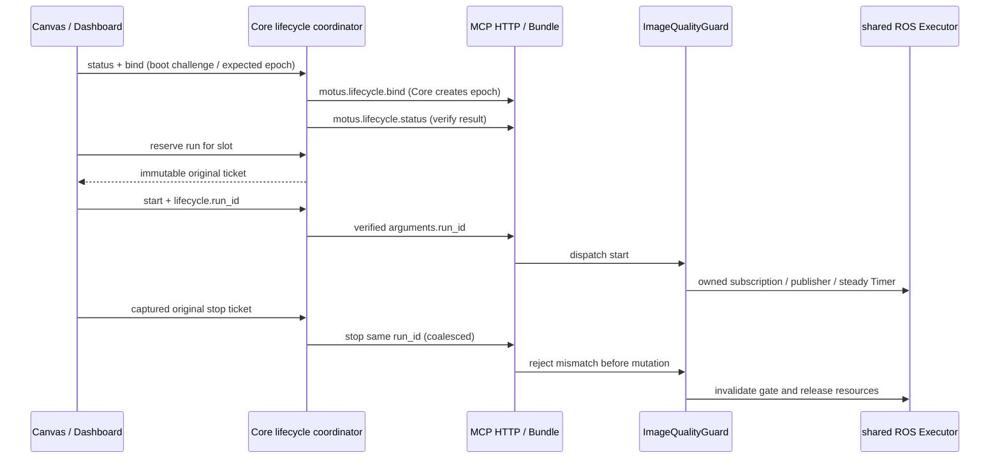

# 开发报告

验证日期：2026-11-05。交付是未提交的本地开发成果；没有推送、PR、review bot、云端构建或真机部署。

## 最新：Core本地构建与真实MCP集成

本轮先只读核查Windows、Clash、Docker Desktop、普通ARM64容器及BuildKit RUN，确认mirrors.tencentyun.com继承自官方ros-base的VPC软件源，不是Docker整体DNS故障。直接访问该域名失败，代理返回502；官方Ubuntu ports的Jammy HTTPS源可达并通过TLS校验。BuildKit默认没有HTTP(S)_PROXY环境，显式预定义build args可正确注入；host.docker.internal到Clash已实测，不使用容器127.0.0.1访问宿主。

主仓库仅对官方agent-core/Dockerfile做网络最小修复：接收build_common已经传入但原本无效的APT_MIRROR，默认/空值使用官方HTTPS ports源，显式Tencent选择保留VPC源；移除apt绕过签名选项。基础镜像digest仍为82d45949e7c3fd85e6baf4a2b24b384a3ec020a5e237c5f801bc2f2269ca649f，Ubuntu22.04/Jammy及原依赖未换。个人代理只用于临时build args，未写项目或镜像ENV，没有修改Desktop代理/网络配置。

Core官方镜像已完整本地构建成功：image-quality-core:local，ID sha256:7afe1b07e8aaf760fd8aa486806da5f9ea5fca3e5810f1e3fce1bf820c13ce7d，linux/arm64。ffmpeg等依赖安装完成；uv实际安装91个Python包，uv pip check兼容性通过，11个关键模块及4个命令行工具实际加载/执行成功。Driver镜像保持be6455114b2dfd81efd0d73af2d41f8376f7969b4a213bd225addc87a70ab76a/linux-arm64，不重复构建或重跑145项。

使用新建内部Docker网络与volume-nocopy空数据卷启动真实Core官方CMD，HTTPS15678、Owner与ROS bridge健康；无主机网络、设备、Docker/DBus挂载或宿主端口发布。Driver只读挂载新增验证bootstrap，仅配置Guard，但复用镜像内真实Bundle/Handler/Runtime，没有启动Camera或厂商控制器。认证与公共接口保持原样，HTTPS证书与主机名校验开启。

新增tests/container_guard_mcp_server.py和tests/container_core_driver_integration.py，实际执行initial/leave-active/recover三个场景共54项断言全部通过，覆盖真实Core→Driver MCP发现、metadata传递、Core签票、重复启停、缺票/伪造拒绝、旧stop隔离以及异常重启后显式stop-only恢复。该54是场景断言数，含重复健康检查，不当作54个独立单元测试；本轮没有重跑无修改的全部测试。

Core正常SIGTERM记录完整应用/ROS shutdown，退出143；SIGKILL退出137，OS锁释放，Driver继续持原run，新Core拒绝旧票直接调用，显式恢复后才能停止。Driver最后SIGTERM退出0，节点/资源归零，HTTP与ROS线程均结束。所有本轮容器、测试卷和内部网络已删除，两个本地镜像保留。构建/运行是ARM64仿真，不是云端构建或Bumi真机；本轮只验证MCP控制面，没有真实摄像头或跨容器DDS到Dashboard验收。

legacy旧Card延迟请求顺序、UNKNOWN项目子Card恢复边界保持不变，源码仍有项目gate/PROJECT_BUSY，不能把独立Card恢复通过扩大成自动项目恢复完成。完整网络矩阵、命令和结果见TEST_REPORT首节。

## 上一轮Driver本地镜像复验

Driver官方Dockerfile已实际重建通过，标签 `image-quality-guard:local`，image ID `sha256:be6455114b2dfd81efd0d73af2d41f8376f7969b4a213bd225addc87a70ab76a`，平台为 `linux/arm64`。构建使用现有缓存，不是无缓存重建；没有push。

原LD_LIBRARY_PATH引用了固定base中不存在的变量，最终值带尾部冒号。该空项会加入当前目录库搜索，属于明确可去除问题，不能仅把警告当作缺少ROS库。最小修改是 `ENV LD_LIBRARY_PATH=/work/noetix_sdk_bumi/dds/aarch64/lib`，不改其他库目录或算法。最终重建无UndefinedVar警告。现有CMD中的ROS和两个消息工作区setup仍负责补齐ROS动态库路径，容器实测rclpy和真实DDS可正常加载/运行。

新增 `tests/container_image_quality_smoke.py` 和 `tests/run_container_validation.sh`，复用镜像内真实模块和实际BumiDeviceBundle类，构造仅启用Guard的配置，避免main()中的SDK/Camera初始化。测试在 `--network none`、无设备/特权/主机网络、只读挂载验证文件的ARM64容器执行。模块SHA256与本地待审版本相同，未用主机算法替换镜像模块。

本轮4项镜像验证及141项完整质量测试全部通过（含7项真实ROS2 DDS测试），没有跳过；镜像环境为Humble/Python3.10/OpenCV5.0.0/NumPy2.2.6，运行在ARM64仿真上，不能据此宣称Jetson性能验证。新增SIGTERM探针在真实Node运行后停止容器，重复stop_all后Node=0、resources_pending=false、Executor停止、工作线程结束，退出码0、非OOM。未观察到本轮覆盖路径的资源泄漏；启动失败/清理异常路径的隔离测试仍与正常容器退出证据区分。

上轮Driver验证之后，Core官方Dockerfile曾因 `mirrors.tencentyun.com` DNS失败、apt无法定位ffmpeg而构建失败。此为历史结果；最新一轮已完成上节所述Dockerfile修复、Core构建和真实MCP验收。Driver首次完整容器回归缺少工具挂载的环境错误也已修正。

当前结论：Driver镜像构建通过、隔离容器运行通过、合成JPEG的真实ROS2集成通过；Bumi真机与真实摄像头验收仍未执行。此前旧Card顺序和UNKNOWN项目恢复限制没有在本轮改变。

## 架构与约束

Core 锁顺序为 project_lock → Card 槽位锁。单实例工具按 MCP/tool 槽位锁定，不能借不同画布 id 创建并行 owner。登记和状态检查在锁内，网络在锁外，返回以 run_id/修订号比较更新。并发 stop 共享任务，HTTP 取消不取消共享 Card 清理。项目持有冻结的运行目标集合，不能后台读取新布局代替旧目标。

Driver `_generation` 继续隔离进程内旧回调，与上游 run_id 分工。清理失败保留原 runtime/run 归属，同票重试；不得以新 start 覆盖。stop 先到会留下取消墓碑，后到的同票 start 不能复活。容量满时拒绝新登记，允许原 owner 停止。

Core 单 worker，无热重载。进程级文件锁只对共享同一资源目录的进程有效，不宣称解决跨机器多 Owner；Driver epoch CAS、未知状态拒绝接管是额外屏障。Core 重启后内存票据丢失，必须查询 Driver，显式恢复停止权限后再受控绑定，不自动猜测原运行已停止。

## ROS2 实现

沿用 Camera 的 CompressedImage/jpeg 与输入 QoS，不修改 Camera 核心。Runtime 仅在显式票据启动后创建一个消费 Node，并加入已有 Executor，不调用 rclpy.init，不新建 Executor/工作线程，不重新创建摄像头驱动。停止只移除自己的 Node。

最新帧槽位覆盖历史帧，Timer 消费一次，单调时钟保证最大分析频率。JSON 发布与 analyzer 操作都经过 Guard 的 generation/run gate。无效 JPEG 复用阶段 A 的错误语义。发布器错误写入 runtime info，不能伪造分析成功。

## 兼容性

只有声明 x-lifecycle 的工具采用严格票据。旧 Card 的普通业务参数（包括名为 run_id 的业务字段）不应被全局过滤；旧 stop 保持原签名。Bundle 本地 stop_all 对严格插件调用 shutdown，对旧插件仍 stop。LLM 的业务 Schema 去除系统票据，并在真实 call_tool 路径再次拒绝受保护动作或伪造票据。

兼容旧 Card 不等于为其增加 Driver 级 run_id 防护；未迁移的旧 Card 仍遵循原有能力与限制。部署必须配套升级 Core/Canvas/Driver，否则 Guard 会拒绝缺少票据的调用。

## 文档依据与范围

已结合仓库 README、README_zh、Driver README_dev、Bumi README、现有 Camera、Bundle 与 control_stream 包/测试实现。用户提供过实习生 landing 文档长截图；本地缺少可逐字核验的原始文档，未假称完整读取其中不可辨认部分。已确认的本地分支与审核规则持续生效，未执行其中 PR/机器人部署操作。

实际测试与构建结论见 TEST_REPORT；尚未进行浏览器人工验收、Bumi 摄像头实测或阈值标定。
