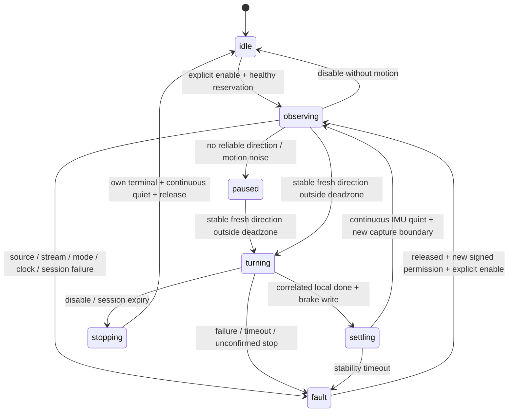

# Bumi Sound Facing——持续听声转身

本 Card 将稳定声源方向转换为可取消、可多次执行的机体朝向调整。复用现有声学估计器和同 Bundle 的唯一 LocoPlugin；不实现新定位算法、速度控制循环、行走、追逐、规划或动作回放。

Agent 和 Canvas 仅能在独立操作员签名授权内通过现有 MCP 路径明确 `enable_follow`。注册默认关闭；Driver 启动、Canvas start、配置保存和重启均不启用追踪。普通访问 token、`dangerous`、`instance_id` 和公开的 `session_id` 都不是运动许可。未配置受信任公钥时 fail-closed。

本轮未连接机器人，所有离线动作均为模拟。真实声音精度、机械转向和物理停车尚未验收。

## 输入契约

核对 Driver 基线 `814b3ca953d33eba0aca9a61dcefa773f5da483b` 及官方 main `79e3740ec02f7156e66f563b106b671a851f8d43`（2026-11-11）。现行 `direction_card.py` 发布 `/<namespace>/sound_direction`，ROS 类型 `std_msgs/msg/String`，Canvas format 为 `sensor/sound-direction`。以源码为准，不能只按 #376 初始 PR 描述假设使用 typed message。

合成示例：

```json
{
  "state": "fresh",
  "trigger": "sound_activity",
  "timestamp_ms": 1800000001000,
  "angle_deg": 40.0,
  "angle_convention": "robot_front_0_left_positive_ccw",
  "audio_window_start_us": 1800000000800000,
  "audio_window_end_us": 1800000001000000
}
```

前方 0°，左正、右负，后方 ±180°。`timestamp_ms` 是结果发布时刻，来自 `published_us // 1000`；`audio_window_start_us/end_us` 才是声学窗口。接收单调时间只用于断流检测，不能冒充采集时间。

现有估计器处理 8 通道、16 kHz 音频，最多保留 8 个活动帧，每通道至少累计 1024 个样本才估计，活动结果按 100 ms 节流；不是固定窗口、恒定 10 Hz。活动停止约 1 s 后发布 `no_event`，最后方向接收超过 2 s 可发布 `stale`；非 fresh 通常每 500 ms 重发，捕获阻塞时不保证频率。

SDK 时间戳须具有 Unix 微秒形状，否则窗口置零并被拒绝。SDK 时间戳的物理含义、与主机偏差仍需现场验证。观测没有 confidence、声源身份、标定代次，不能按虚构字段筛选。producer 每次估计重载标定；Card 通过原 `sound_direction.info` 持续核对 worker 存活及 front/right 标定，失效即停止会话。

## 独立操作员授权

官方 Core `2b00f1db2f81b80c27a5249a54301acfeb19d068` 的 ACP 是完成回执；Canvas 编辑占用、工具连线和普通访问 token 不提供本 Card 所需的独立限时运动许可。不复用可被 Agent 读取的 Core peer 私钥，也不新增匿名授权 API。

本 Card 使用 `cryptography` 的 Ed25519 验证；**私钥只保存在受信任操作员的独立工作站，不能放入机器人、Driver、Core、Agent 可读文件或 Solution**。Driver 只持有启动时固定的公钥。配置环境变量 `BUMI_SOUND_FACING_OPERATOR_PUBLIC_KEY` 为已审查的公钥 PEM 文件路径，并使用只读文件挂载；MCP 参数及 config 都不能指定、替换或动态重载此公钥。缺失、不可用、可由其他账户写入的公钥文件，以及私钥/非 Ed25519 文件均拒绝。

部署必须保证 Agent 不能修改 Driver 代码、公钥、进程、容器或宿主资源。官方默认 Core 提供 Bash 并挂载 Docker socket；若把这类管理员能力交给 Agent，它可以改写验证器，Driver 内的签名校验无法保护已被改写的执行进程。操作员已确认当前尚未限制这些管理权限；这一边界仍为 PR 前阻塞。普通 MCP 参数伪造测试不等于验证了管理员权限隔离。

操作员流程（只在受信任工作站执行签名工具）：

1. 用 `tools/sign_sound_facing_authorization.py --private-key operator.pem --generate` 生成带口令的 Ed25519 私钥及 `operator.pub.pem`。工具需要交互终端，拒绝覆盖已有文件。只把公钥安装到 Driver。
2. Card 已 start、停用且身体占用已释放时，调用 `prepare_authorization`。从返回值 `authorization.request` 复制完整 JSON 到操作员工作站的 `request.json`。
3. 工作站运行 `python3 tools/sign_sound_facing_authorization.py --private-key operator.pem --request request.json --valid-for-s 120`；核对设备、进程、会话和 chassis 范围，输入 APPROVE 和私钥口令。
4. 把输出的签名 JSON 字符串交给 `authorize_follow` 的 `authorization` 参数。此动作只验证并存储授权，不运动。随后 Agent/Canvas 可执行 `enable_follow`。
5. Agent 显式 `renew_follow` 维持短会话，但不能延长操作员授权。默认会话 30 s；独立授权最多 300 s，从 Driver 生成请求的单调时刻算起，包含离机签名和传输耗时。旧签名重放不能延长时间。
6. `disable_follow`、`cancel`、`stop`、故障、配置改变、到期或进程重启退役授权。重新启用需要新请求、新签名；旧请求、旧进程和旧会话不能复活。

签名绑定 schema、设备 namespace、随机进程 nonce、请求 ID、会话 ID、chassis 资源和有效期；这些公开 ID 本身没有权限。私钥持有者是独立授权主体，TTY 是防误操作界面，不是“人类存在”的密码学证明。

Core 断连或 Agent 不再续期时，短会话到期停止；声源断流另受 stream_timeout 保护。关闭操作员浏览器不会产生独立连接事件，需显式取消或等待有限授权到期。所有停止操作均无需签名。

## 工具和会话

单实例 actuator `bumi_sound_facing`，YAML `plugins.bumi_sound_facing.enabled: false`。启用注册还需同 Bundle 的 loco 和 sound_direction 已启用。配置 enabled 只决定注册。

| action | 参数与行为 |
|---|---|
| `start` | 创建自身只读 ROS 资源；input_topic 可省略，显式设置仅接受本 Bundle topic；兼容 Core 的同一 input_topics |
| `info` | 读取状态、原因、会话剩余时间、当前 turn ID、完成次数和最后结果，不续期 |
| `prepare_authorization` | 仅在已停用且释放占用后创建新签名请求，不授权、不运动 |
| `authorize_follow` | 验证独立操作员签名 JSON；不运动、不延长已使用授权 |
| `enable_follow` | 在有效签名范围内检查源健康、walking、IMU 和身体占用；重复调用不续期 |
| `renew_follow` | 当前 session_id 仅用于关联；会话续期始终受操作员授权期限约束 |
| `disable_follow` | 立即撤销会话，只取消本 Card 动作，等待原 worker 和连续 IMU 安静后释放占用 |
| `cancel` | disable_follow 的安全别名，无需授权 |
| `stop` | 撤销会话、有界收尾，回收自身订阅、timer、publisher、node 和监督线程 |
| `config` | 原子校验参数；实际变更结束会话，收尾未完成时拒绝应用；相同配置不启用、不续期 |

会话默认 30 s，可配置 1–60 s。需要持续追踪的调用方应在到期前（例如每 10 s）明确续期；Card、传感器消息和状态轮询均不自动续期。失去管理、断流、源/模式/控制权异常、动作失败或时钟跳变会撤销会话，必须再次明确 enable。ID 是进程内关联值，不是身份凭据。旧 ID 不能续期新会话，重启不恢复 ID。

标准 Driver MCP arguments 示例（会导致运动，仅用于经批准的现场阶段）：

```json
{"name":"bumi_sound_facing","arguments":{"action":"enable_follow"}}
```

```json
{"name":"bumi_sound_facing","arguments":{"action":"renew_follow","session_id":"从 enable 返回值读取"}}
```

```json
{"name":"bumi_sound_facing","arguments":{"action":"disable_follow"}}
```

Core Canvas HTTP 使用既有 `/api/mcp/{id}/call`，body 为 `{"tool":"bumi_sound_facing","arguments":{"action":"enable_follow"}}`，沿用现有认证。Agent 使用 Core 转换后的 `mcp__{id}__bumi_sound_facing__enable_follow`。Card 接受 Core 注入的 `_trace_id`、`_tool_name`、`instance_id` 诊断元数据，不把它们当作运动所有权或身份声明；拒绝其他未知参数和任意输入 topic。

状态输出：`/<namespace>/bumi_sound_facing/state`，String / `data/json`，约 5 Hz。字段为 state、reason、running、enabled、session_id、session_remaining_s、motion_reserved、turn_action_id、turns_completed、last_result、settings、physical_motion_verified:false。`turn_action_id` 是内部关联 ID，不是 Core pending action。

## 持续状态机



每次需要至少 3 个不重叠采集窗口和足够采集跨度。滑动重叠窗口不累计证据，反向重叠窗口也会清除旧稳定证据。重复、乱序、非法角度、未来/过期时间、零窗口、过长窗口和错误约定均拒绝。使用圆周角差与均值处理 ±180°，大跳变重积累。不能辨认多个说话者，仅保守拒绝方向不稳定。

运动期间和 settling 期间丢弃触发证据。只有当前 owner、匹配 turn ID、本地 terminal、done、相同 requested_angle、有限且绝对值 ≤2° 的残差及 stop_command_sent=true 才进入 settling。连续 IMU 角速度 ≤0.1 rad/s、航向相对安静锚点变化 ≤0.5°，满足 settle_s 后重新开窗。新窗口必须整体晚于稳定等待结束，不能用重新发布时间的旧声音再次转身。

settling/取消后的安静等待预算为 max(6 s, 3×settle_s)。取消后原 worker 超过 5 s 未返回终态、制动失败或 IMU 无法确认安静，会保留占用并 fault；stop 本身最多收尾等待 6 s，然后回收本 Card ROS 资源并保留故障占用。

反向需要 reversal_hold_s，未经过前方 release 带时反向触发线提高到 deadzone_deg + release_deg，减少左右振荡。无累计转角和次数上限；每次角度来自新稳定方向，仍经过原 Driver ±360° 单次校验（方向输入本身在 ±180° 内）。

运动噪声通过运动/安静窗口隔离。持续机载播音、现场反射或多个稳定干扰源仍可能产生可信方向；现有接口没有说话者身份，须在真机验收中检查，不能声称软件可排除所有自噪声。

## 参数

YAML 与 MCP config 共用相同 schema、默认值及范围；release < deadzone，max_gap ≤ stream_timeout。

| 参数 | 默认 | 范围 / 用途 |
|---|---:|---|
| deadzone_deg | 12 | 3–60°，触发线 |
| release_deg | 6 | 0–30°，迟滞释放带 |
| spread_deg | 12 | 1–30°，最大圆周分散 |
| stable_windows | 3 | 整数 3–20，独立窗口数 |
| stable_span_s | 0.6 | 0.2–5 s，证据采集跨度 |
| max_age_s | 1 | 0.1–2 s，采集结束与发布时间双年龄 |
| max_window_s | 1 | 0.05–2 s，最大采集窗口 |
| max_gap_s | 0.8 | 0.1–2 s，证据间隙 |
| stream_timeout_s | 1.5 | 0.3–5 s，断流撤销会话 |
| settle_s | 0.8 | 0.5–5 s，连续安静等待 |
| reversal_hold_s | 2 | 1–10 s，反向等待 |
| turn_timeout_s | 80 | 1–80 s，上层等待预算，原 Driver 超时另行保留 |
| session_timeout_s | 30 | 1–60 s，必须显式续期的会话期限 |

墙钟相对单调钟跳变超过 250 ms 撤销会话，避免跨时钟使用旧方向。使用 mono-before/wall/mono-after 区间采样，记录 clock_diagnostics；采样自身超过 250 ms 单独报 capture_clock_sampling_delayed 并撤销，阈值没有放宽。本轮独立 WSL 探针记录到实时钟前跳约 2.27 s、同时单调钟只前进约 0.01 s；这不是声源采集时间与接收时间混用，也不能通过修改宿主时钟配置或忽略跳变来消除测试失败。恢复后仍需新签名，不自动恢复运动。

外部 source.info 在专用查询线程中执行，调用方单次等待预算为 50 ms（不提供 OS 调度硬实时保证），且不持有 engine/lifecycle 锁；结果有代次校验。查询阻塞时 fail-closed，旧结果不能复活新会话。最多保留一条阻塞查询；Python 无法强杀该回调，停卡不等待它，回调返回后丢弃退休结果，不能声称所有外部线程硬实时退出。

## 所有权与完成

整个 enabled 会话（含 paused/settling）预留身体，不抢占现有 move/body_action/servo。所有权是不可序列化的 Python object；MCP 不能指定 owner。取消只匹配 owner + turn ID，置位原 stop event；不调用全局 stop_move、不新增速度线程。外部全局 stop 保持原行为，会使本会话失效；不会自动恢复。

执行链为 rotate_owned → 原 _do_destination → 原 _do_rotate_worker → 原 IMU 闭环。owner-scoped interrupt 不依赖尚未返回的 action_id；取消在 SDK preflight 前后保持 sticky。授权/会话期限还在动作接受及每次非零速度发布前检查，防止 SDK 预检延迟越过期限。内部 worker 原子发布本地终态并退休 ID，不发没有 Core pending 对应的 ACP callback。enable 是同步会话状态，无 x-completion。原公开 loco_relative_move 的异步 ACP 接口保持兼容。网络 ACP 回调不能成为本 Card 的运动完成依据。

SDK IMU getter 没有源采样时间，SDK 写零成功也不能证明实际停止。因此 last_result 的 physical_stop_confirmed 和输出 physical_motion_verified 始终 false。卡住的厂商调用仍需要现场物理停止手段；不能用进程重启掩盖未确认停车。

复现、真实 Core 软件集成范围、已知基线问题与构建步骤见 [审查记录](SOUND_FACING_REVIEW.md)。分阶段物理验收见 [验收文档](SOUND_FACING_HARDWARE_ACCEPTANCE.md)。
