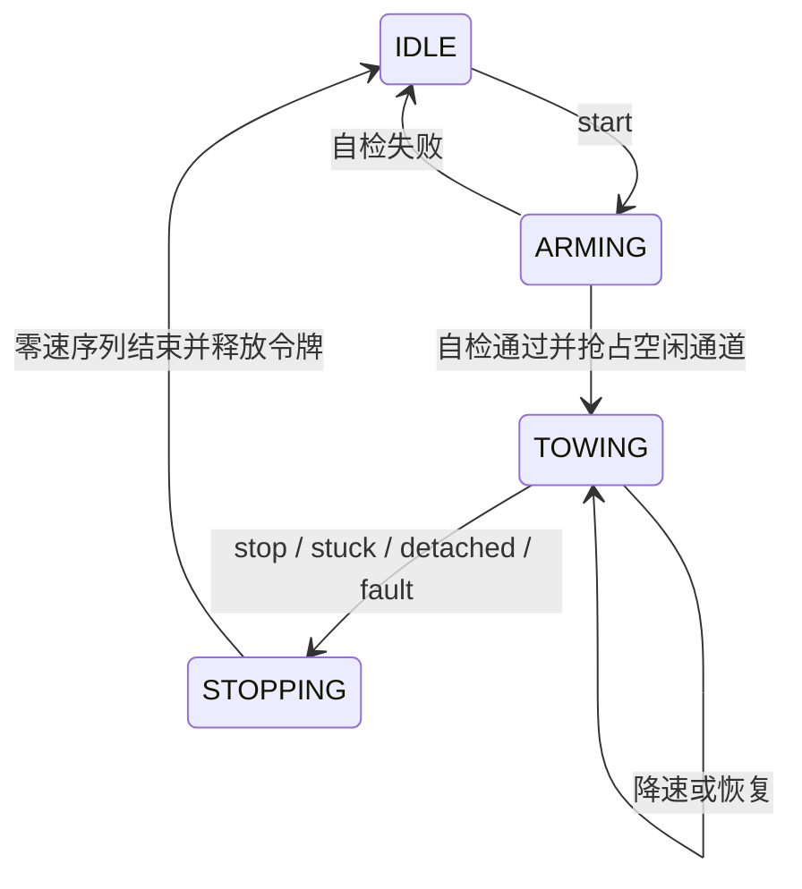

# AS2W towing

## 层归属、独立能力与背景

1. **层归属**：AS2W driver 层。算法使用本机型 SportModeState 的速度坐标约定、LowState 的 IMU 以及 BMS 电流。DDS 消息、采样率和可用字段随机型与固件变化。
2. **新增功能声明**：`towing` 独立订阅原始 DDS 流，计算拖拽比，执行纵向速度闭环、限速和停车。工具命名空间为 `towing`，输出为 `/{namespace}/state/towing`（`data/json`）。运动指令通过共享 SportClient 发送。卸掉 `loco`、`loco_servo`、`loco_state`、`battery_power`、`imu`、`lidar` 后仍能运行。只有共存时，底盘仲裁读取各控制入口的占用标记。
3. **能力边界**：接受 `load_class` 标签和 `vx` 巡航速度，直行牵引并报告拖拽比、趋势、速度、坡度、电流变化、限速和近期事件。范围限定为纵向速度控制。步态、控制模式、路径规划、真实牵引力及牵引点检测均在范围外。
4. **添加背景**：`loco` 发运动指令，`loco_state` 报高层状态和速度，#574 的 `battery_power` 报电池功率。拉工具车时，需要能从反馈识别卡阻和疑似脱钩并自动停车的控制入口。

## 调用与状态

默认 `towing.enabled: false`。配置中出现 `towing` 段时即注册工具，关闭时 `start` 返回 `DISABLED`。调用参数示例为 `{"action":"start","load_class":"cart","vx":0.30}`。巡航速度须在配置的最小与最大速度之间。用 `{"action":"info"}` 读快照，用 `{"action":"stop"}` 执行停车。负载类别是标签，各类别共用同一组判据。

`ARMING` 检查配置、调用参数、通道占用及独立速度和 IMU 采样的新鲜度。占用时返回 `{"error":"speed channel busy","owner":"..."}`。其他控制入口与 towing 的申请在同一把锁下进行。既有动作、实时 servo、特技和 SLAM 导航进入运动前检查当前 owner。关闭服务时，先完成 towing 的停车，再拆除其他卡。

停车按 `loop_hz` 间隔尝试连续发送 `zero_frame_count` 帧 `Move(0,0,0)`。任一帧未获接受时，记录故障并尝试 `StopMove`，在停车序列结束后释放运行令牌。两种停车路径都未获确认时，通道进入 `towing_fault` 并拒绝交接，重新调用 `towing.stop` 可重试。SDK 接受指令只证明得到回执。当前没有真机停稳验证。tick 间隔与 RPC 耗时由单调时钟检查，超时排队的 towing 请求在 RPC worker 中丢弃。持有令牌或停车未确认期间，旧控制入口的 SportClient 状态查询返回忙，以保留 RPC 通道供停车。驱动进程内的令牌覆盖本 bundle 的发送入口，遥控器和其他 DDS 进程在仲裁范围外。

## 判据

- 速度来自 `rt/lf/sportmodestate`。用同一帧四元数 yaw 把 world-frame 平面速度投影到本体前向。角速度取 `gyroscope[2]`。两路新鲜度分别以本机 DDS 回调的单调接收时间判断。
- `r = clamp((vx_cmd - vx_meas) / max(vx_cmd, 1e-6), -1, 1)`，其中 `vx_cmd` 是测量前最后一次下发的速度。到达告警阈值后，以 `a = (r - warn)/(stop - warn)` 从巡航速度线性下调到 `min(vx_cruise, min_speed_mps)`。限速后只有当实测速度允许，才逐步恢复至巡航，恢复上界取 `vx_meas / (1 - warn/2)`，避免速度反馈不变时在限速与巡航间来回切换。达到停车阈值报 `stuck`。
- 从静止起步时，最多给 `stuck_hold_ms` 建立速度。拖拽比低于停车阈值即退出宽限。退出后，停车阈值立即生效。独立卡阻条件为 `vx_meas <= stuck_speed_eps_mps` 且 `vx_cmd > 3 × stuck_speed_eps_mps` 持续 `stuck_hold_ms`。
- 宽限期后，若相邻反馈更新的拖拽比下降超过 `detach_drop_ratio`，且纵向速度差分 `Δvx/Δt` 超过 `detach_accel_mps2`，报告疑似脱钩并停车。判定时也用同一指令速度重算两帧的比值，排除卡本身的限速造成的比值跳变。
- 来自 `rt/lowstate` 的 pitch 转成角度后按 1 秒时间常数低通，`abs(slope_deg) > slope_warn_deg` 时告警。来自 `rt/lf/bmsstate` 的电流上报值和绝对值趋势作为独立诊断信号，拖拽比和停车阈值保持速度公式定义。
- 活动期间按 `publish_hz` 周期发快照，状态、限速状态和坡度告警变化立即发布。快照含最近 16 条事件。停车完成后保留终态供 `info` 查询。失鲜量以及未确认的功率和牵引力填 `null`。

| 参数 | 默认值 | 校验与单位 |
| --- | ---: | --- |
| `enabled` | `false` | 布尔 |
| `loop_hz` | 20 | 正值且 ≤100 Hz，周期短于 loop 超时 |
| `publish_hz` | 5 | 正值且 ≤ loop 频率 |
| `max_speed_mps` | 0.5 | 软件硬上限 0.5 m/s，须为正 |
| `min_speed_mps` | 0.05 | 正值且 ≤最大速度 |
| `drag_warn_ratio` | 0.25 | 正值且小于停车比 |
| `drag_stop_ratio` | 0.6 | 比值，≤1 |
| `stuck_speed_eps_mps` | 0.02 | 正值，3 倍须小于最大速度 |
| `stuck_hold_ms` | 800 | 正值且 ≤60,000 ms |
| `detach_drop_ratio` | 0.5 | 绝对比值下降量，(0, 2] |
| `detach_accel_mps2` | 0.8 | 有限正值，m/s² |
| `slope_warn_deg` | 8.0 | (0, 90]° |
| `freshness_timeout_ms` | 300 | 正值且 ≤60,000 ms |
| `loop_timeout_ms` | 500 | 正值且 ≤60,000 ms |
| `zero_frame_count` | 5 | 1–100 的整数 |

| 事件 | 条件 | 动作 |
| --- | --- | --- |
| `derate` | 进入告警至停车阈值之间 | 线性限速，仍保持 towing |
| `stuck` | 达到停车比或低速持续判据 | 发送零速序列，停车 |
| `detached` | 拖拽比骤降且纵向加速度超限 | 发送零速序列，停车 |
| `fault` | 速度或 IMU 失鲜、tick 超时、运动 RPC 异常或零速序列未获接受 | 发送零速序列并记录原因。零速未确认时尝试 `StopMove` |

## 边界对照

| 卡片 | 输入 | 输出 | 范围之外 |
| --- | --- | --- | --- |
| `towing` | 巡航速度、负载标签、原始速度/IMU/BMS | 限速或停车指令、`state/towing`、拖拽事件 | 牵引力牛顿值、步态与模式切换、路径 |
| `loco_servo` | `motus.control/1` 连续速度流 | 执行上游速度、watchdog 停车、流控状态 | 牵引负载估计或脱钩事件 |
| `loco_state` | SportModeState | 底盘状态、速度及 `state/odom` | 改写速度或停车 |
| `battery_power`（#574） | BMS 电压与电流 | 功率、已耗能量、估计剩余时间 | 牵引事件或底盘控制 |

## 查重与待核实

2026-11-26 对照上游 `main`（`d6509f67`）、本地 `feat/as2w-leash-load`（`17c6a77e`）以及上游 open / closed-unmerged / merged PR，检索词为 `as2w`、`AS2-W`、`towing`、`leash`。 [上游 PR 列表](https://github.com/4paradigm/phanthymotus-driver/pulls)

- **直接复用**：SportClient 代理、厂商 DDS 类型。按已有里程计代码使用 world-to-body 速度转换约定，但从原始帧独立计算。 [#409](https://github.com/4paradigm/phanthymotus-driver/pull/409/files) [#393（已合并）](https://github.com/4paradigm/phanthymotus-driver/pull/393/files)
- **适配复用**：沿用 main 现有控制入口的互斥锁和占用状态，扩展 towing 的准入及释放。相关 PR 实现上游速度流或导航交接。 [#401](https://github.com/4paradigm/phanthymotus-driver/pull/401/files) [#370](https://github.com/4paradigm/phanthymotus-driver/pull/370/files)
- **确需新增**：历史 `leash_load` 依赖已有卡的数据并给出只读状态。电池功率 PR 仅处理 BMS；已关闭的 accompany PR 只观察固件伴随模式及遥控接管。牵引限速、独立脱钩判定和停车序列由本卡实现。 [#574](https://github.com/4paradigm/phanthymotus-driver/pull/574/files) [#577（已关闭未合并）](https://github.com/4paradigm/phanthymotus-driver/pull/577/files)

| 待核实 | 当前处理 |
| --- | --- |
| 真实牵引力、关节力矩的固件可读性及校准 | `traction_force_n: null`，闭环无需力矩 |
| 原始速度反馈端到端时延及抖动、起步建立速度、降速和停车效果 | 用本机接收时间做新鲜度，真机数值待测 |
| 电池电压字段及电流方向、采样频率、功率口径 | 上报原始电流及幅值趋势，`electrical_power_w: null` |
| IMU pitch 零偏和不同负载/坡度下阈值 | 保留坡度诊断，零偏数值待测 |
| 连续零速回执、固件 watchdog 及异常情况下实际制动距离 | 仅进行本地 mock 验证 |
